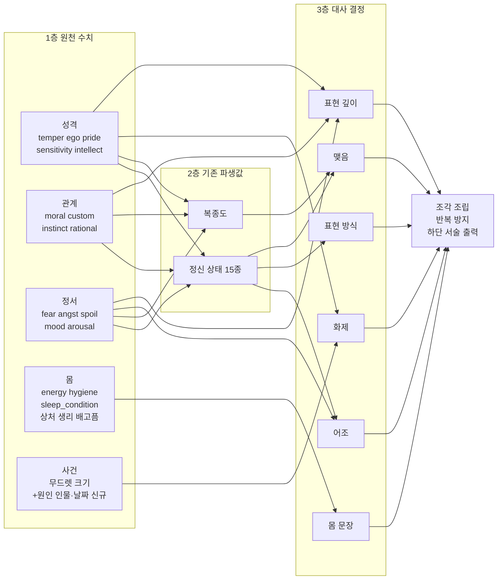

# Wayward → 잭오나 역기획: 노예 반응 체계 변수 매칭 (카일, 2026-10-14)

목적: Wayward의 아내가 "상황에 맞게 말하는" 체계를 잭오나 노예에게 옮기기 전에, 양쪽 설정과 변수를 맞춰 무엇이 이미 있고 무엇이 없는지 정한다.
근거: Wayward 한국어판 index.html(2026-09-30판) 코드, 잭오나 2.4.0.0 QSP(`source/jack_release_2026-10-14_2.4.0.0.qsp`, codex 브랜치), 사용자 제공 노예 정보 화면.
주의: Wayward에는 게임 라이선스 표기가 없다. 구조와 아이디어만 참고하고 코드·문구는 가져오지 않는다.

## 1. 결론
- Wayward는 LLM을 쓰지 않는다. 미리 쓴 문장을 **사건 기억 → 원인 있는 감정 → 아침 상태 → 표현 단계 → 조각 조립(반복 방지)** 순서로 고른다.
- 잭오나는 **재료가 이미 충분하다.** 원인별 감정(무드렛, 밤마다 줄어드는 크기), 성격 수치, 숨은 성향 발견(`*_revealed`), 몸 상태, 정신 상태 15종이 있다.
- 없는 것은 네 가지다.
  1. 감정의 **원인 인물과 날짜**(누가, 언제)
  2. **표현 단계**(속마음을 드러냄/암시/숨김/거짓 표정)
  3. 여러 상태를 묶는 **아침 상태 종합**
  4. **조각 조립과 반복 방지**
- 그래서 지금 출력이 고정 문장이다. 하단 서술은 정신 상태 하나당 한 문장(`$psy_status[...]`)이고, 일기는 무드렛 하나당 한 문장(`$mood_description[...]`)이다.

## 2. 노예 정보 화면 ↔ 변수 (slave_stat에서 확인)
| 화면 | 변수 | Wayward 대응 |
|---|---|---|
| 감수성 | `slave['sensitivity']` | 감정 기복(`volatility`) |
| 성격 (수동적임 등) | `slave['temper']` | 평정(`composure`) |
| 지성 | `slave['intellect']` | 없음 |
| 자아 (단호함 등) | `slave['ego']` | 자신감(`selfConcept.confidence`) |
| 태도 (개방적 등) | `slave['pride']` (표시는 반대 방향) | 개방성(`selfConcept.openness`) |
| 기분 (황홀함 등) | `slave['mood']` | 기분(`dailyState.mood`) |
| 노예의 특성 | `$slave_features_list` | 성격 태그(`traits`, 예: cold_pragmatist) |
| 하단 서술 | `$psy_status[$slave_psy_status]` | 출력 문장. 잭오나는 정신 상태당 고정 1문장 |
| 우측 규칙 패널 (잠자리, 식단, 식사량, 규칙) | 규칙 변수들 | 간접 통제(부추김/제한, `latitude`) |

## 3. 감정 매칭: Wayward 감정 ↔ 잭오나 무드렛
잭오나 무드렛은 노예 배열의 키(`slave['neg_pain']` 등)에 크기를 담고, 밤마다 `$mood_drop`/`$mood_rise`로 줄어든다. Wayward 감정(세기, 원인, 대상, 끝나는 시각)과 같은 역할이다.

| Wayward 감정 | 잭오나 무드렛 (예) | 차이 |
|---|---|---|
| fear (두려움) | `neg_fear`, `neg_pain` | 원인 인물·날짜 없음 |
| shame / humiliation (수치·굴욕) | `neg_shame`, `neg_naked`, `neg_forced` | 〃 |
| anger / contempt (분노·경멸) | `neg_abuse`, `neg_rules`, `neg_spoil`, `neg_no_praise` | 〃 |
| disgust (혐오) | `neg_disgust` | 〃 |
| sadness / numbness (슬픔·무감각) | `neg_angst`, 정신 상태 `broken`/`depresive` | 무감각은 상태로만 있음 |
| pride / elation (자부심·고양) | `pos_praise`, `pos_reward`, `pos_slave_winner` | 〃 |
| tenderness / devotion (애정·헌신) | `pos_gentle`, `pos_slave_love`~`love6` | 〃 |
| ecstasy / desire (황홀·욕구) | `pos_orgasm`, `pos_multiple_orgasm`, `neg_horny` | 〃 |
| guilt / regret (죄책·후회) | `sin`(죄 수치), `pos_no_punish` | 감정이 아니라 수치로 있음 |

## 4. 그 밖의 상태 매칭
| Wayward | 역할 | 잭오나 | 판정 |
|---|---|---|---|
| dailyState (기력, 기분, 몸 상태) | 아침 상태 | `energy`, `stamina`, `mood`, `hygiene`, `sleep_condition`, `neg_exhausted`, `neg_hungry`, `neg_menstruation`, `neg_slave_wounded` | 재료 있음. 묶는 단계만 없음 |
| latentTraits + noticedLatentTraits | 숨은 성향과 발견 | `courage_revealed`, `exhibitionism_revealed`, `deprivation_attitude_revealed` 등 | **같은 구조가 이미 있음** |
| identityStrain | 정체성 갈등 | 직접 대응 없음. 근사: `angst`와 `moral`의 차이 | 필요할 때 계산식으로 |
| trust / comfort | 주인에 대한 신뢰 | **헌신 `moral`**(0~5). 디버그 화면의 "충성심 요소"로 습관·인식·사육이 쌓여 오른다. 천천히 쌓이는 관계 수치라 신뢰와 성격이 같다 | 새 변수 불필요. 정신 상태는 신뢰가 아니다 (8절) |
| notedMoments, topOfMind | 강한 순간 기억, 오늘 마음에 걸리는 일 | 없음. 가장 큰 무드렛으로 대신 가능 | 신규(작게) |
| 대사 반복 방지(cooldown) | 같은 문장 연속 방지 | 없음 | 신규 |

## 5. 사건 매칭: 매일 일어나는 일만 기준으로
손님 접대는 창관 모드 전까지는 특정 이벤트 액션이다. 첫 적용 대상에서 뺀다.

| 잭오나 일상 사건 | 생기는 무드렛 | 빈도 |
|---|---|---|
| 처벌 (`torture_intensity`) | `neg_pain`, `neg_fear`, 처벌 안 함이면 `pos_no_punish` | 높음 |
| 보상·칭찬 (`interaction_reward_level`, `cheer_rate`) | `pos_praise`, `pos_reward`, 없으면 `neg_no_praise` | 높음 |
| 성관계 | `pos_orgasm`, `neg_forced`, `neg_raped` | 높음 |
| 잠자리 (규칙 패널) | `pos_sleep`, `neg_bad_sleep`, `pos_slept_with_master` | 매일 |
| 식사 (규칙 패널) | `pos_cookie`, `neg_slave_food`, `neg_hungry` | 매일 |
| 일·수업 | `pos_job`, `neg_job` | 높음 |
| 청결·옷 | `pos_slave_clean`, `neg_slave_dirty`, `neg_naked`, `pos_clothes` | 매일 |
| 규칙 | `neg_rules` | 매일 |

## 6. 최소 추가안 (설계 방향, 미확정)
1. **원인 기록**: (폐기) 날짜·인물 변수를 새로 두지 않는다. 9절대로 기존 행동 기록 배열의 층(오늘/최근/평생)으로 "언제"를 대신한다.
2. **표현 단계**: 8절 모델을 따른다. 표현 깊이는 헌신(`moral`)과 성격 수치로, 표현 방식은 정신 상태로 정한다. (처음 초안의 "정신 상태로 깊이를 정함"은 폐기)
3. **출력 위치**: 노예 정보 화면 하단 서술. 지금의 정신 상태 고정 문장을 앞에 두고, 가장 큰 무드렛 + 원인 + 몸 상태 조각을 붙인다. 이미 노예 상태를 서술하는 자리라 화면 구성이 바뀌지 않는다.
4. **조각 조립과 반복 방지**: 샘플(QSP 시험 통과)과 같은 방식을 쓴다. 조각 표는 `{when}`/`{who}` 빈칸 표시와 `replace`를 쓴다. QSP 함정은 세 가지다. `$이름`과 `이름`은 같은 변수이고, 문자열 안의 `<<>>`는 대입할 때 계산되며, 한 줄 `elseif`는 안 된다.
5. **세이브 호환**: 새 키가 비어 있으면 지금과 같은 고정 문장이 나오게 한다.

## 7. 사용자 결정이 필요한 것
1. 8절의 변수 상관관계(어떤 변수가 어느 결정에 들어가는지)와 초안 수치
2. 첫 샘플 출력 위치 (초안은 노예 정보 하단 서술)
3. 첫 샘플에 넣을 사건 (초안은 처벌, 칭찬·보상, 잠자리 3종)
4. 구현 담당 (역할상 로컬 도구 또는 Codex)

## 8. 대사 결정 모델: 변수 상관관계 (초안)

### 8.1 원칙
- **층을 나눈다.** 잭오나의 정신 상태와 복종도는 이미 여러 원천 수치를 합친 파생값이다(아래 8.2). 대사 모델은 파생값을 먼저 쓰고, 원천 수치는 파생값이 담지 못하는 뜻에만 쓴다. 같은 수치를 같은 결정에 두 번 세지 않는다.
- **결정 하나에 질문 하나.** 대사는 여섯 개의 결정(어조, 몸, 화제, 깊이, 방식, 맺음)으로 나누고, 결정마다 답하는 질문을 하나로 정한다.
- **우선순위가 있다.** 강한 상태(정신병, 발정, 극심한 피로)는 다른 결정을 덮어쓴다.

### 8.2 이미 있는 파생값 (코드 확인)
| 파생값 | 계산 위치 | 들어가는 원천 수치 |
|---|---|---|
| 복종도 `obedience` | `#static_base` | 두려움×2(+본성 보정), 기분, 헌신×4, 사육×2, 습관, 인식, 절망, 용기, 응석×2(−), 태도·성격·자아·지성(−) |
| 정신 상태 15종 | `#static_base`의 `$newloc_update_slave` | 기분, 헌신, 두려움, 용기, 절망, 응석, 인식, 흥분, 성격·자아·태도, 감수성, 가장 큰 동기(`max_motivation`) |
| 무드렛 크기 | 행동 결과, `next_day` | 사건별. 밤마다 `$mood_drop`/`$mood_rise`로 감소 |

주의: 무드렛 크기의 척도가 제각각이다. `pos_orgasm`은 작은 정수지만 `neg_clothes`는 표시용으로 100이 들어가고, `neg_pony_died`는 최대 100이다. 화제 선택에는 무드렛별 가중치 표가 필요하다.

### 8.3 흐름도

### 8.4 상관 행렬 (● 주 입력, ○ 보정, 빈칸 사용 안 함)
| 변수 | 어조 | 몸 문장 | 화제 | 표현 깊이 | 표현 방식 | 맺음 |
|---|---|---|---|---|---|---|
| 정신 상태 | ● | | | | ● | ○ |
| 복종도 | | | | | | ● |
| 기분 `mood` | ● | | | | | |
| 헌신 `moral` | | | | ● | | |
| 두려움 `fear` | | | | ○ 감춤 쪽 | | |
| 자아 `ego` | | | | ○ 적대 감정은 드러냄 쪽 | | |
| 태도 `pride` | | | | ○ 취약·긍정 감정은 감춤 쪽 | | |
| 성격 `temper` | | | | ○ 적대 감정은 드러냄 쪽 | | |
| 감수성 `sensitivity` | | | ○ 부정 감정 가중 | ○ 긍정 감정은 드러냄 쪽 | | |
| 기력·청결·잠자리·상처·생리·배고픔 | | ● | | | | |
| 흥분 `arousal`, `neg_horny` | | ○ | ○ | | | |
| 무드렛 크기·원인 | | | ● | | | |

### 8.5 진행도 (결정 순서와 규칙)
| 순서 | 결정 | 답하는 질문 | 입력 | 규칙 (초안 수치) | 출력 |
|---|---|---|---|---|---|
| 0 | 덮어쓰기 | 정상 대화가 가능한가 | 정신 상태, 기력 | 정신병(broken)이면 무표정 조각 하나로 끝낸다. 기력 −4 이하면 몸 문장만 쓴다 | 진행 / 종료 |
| 1 | 어조 | 어떤 말투와 온도로 말하는가 | 정신 상태 + 기분 | 정신 상태 15종을 5개 어조로 묶고(아래 8.6), 기분 −5~5를 나쁨/보통/좋음으로 나눈다 | 인사 조각 묶음 |
| 2 | 몸 문장 | 몸이 무엇을 말하는가 | 기력, 청결, 잠자리, 상처·생리·배고픔 무드렛 | 가장 나쁜 하나를 고른다(상처 > 배고픔 > 생리 > 탈진 > 더러움 > 잠자리). 모두 보통이고 숙면이면 개운함 | 몸 조각 하나 또는 없음 |
| 3 | 화제 | 오늘 마음에 가장 걸리는 일은 무엇인가 | 무드렛 크기, 원인 날짜, 감수성 | 점수 = 정규화 크기(0~5) × 무드렛 가중치 × (부정이면 1+감수성/5) + 어제 일이면 1. 최고점 하나 | 감정 묶음 + {who} {when} |
| 4 | 표현 깊이 | 그걸 얼마나 털어놓는가 | 헌신 + 감정 종류별 보정 | 취약(두려움·수치·슬픔): 헌신 − 태도/2 − (두려움≥4면 1) 적대(분노·원망·혐오): 자아/2 + 성격/2 − 두려움 긍정(자부심·애정·고마움): 헌신 + 감수성/2 − 태도/2 값 4 이상 드러냄, 2~3 암시, 1 이하 감춤 | 드러냄/암시/감춤 |
| 5 | 표현 방식 | 감출 때 어떤 모습으로 감추는가 | 정신 상태 | 감춤이면 정신 상태로 모습을 고른다. 두려움·우울·슬픔은 떨림·시선 회피, 혐오감·저항·증오는 거짓 표정, 순응형은 짧은 대답 | 내레이션 조각 |
| 6 | 맺음 | 다음 지시에 어떻게 응하는가 | 복종도, 정신 상태 | 복종도 높음 "시키실 일이 있나요", 보통 침묵, 낮음 거부·회피 조각 | 맺음 조각 또는 없음 |
| 7 | 조립 | | 1~6의 결과 | 순서대로 이어 붙이고, 최근 2일 안에 쓴 조각은 피한다 | 하단 서술 문장 |

### 8.6 정신 상태 → 어조 5종 (초안)
| 어조 | 정신 상태 | 말투 |
|---|---|---|
| 헌신 | servile, obedient, horny | 공손하고 따뜻함 |
| 순응 | docile, soft, optimistic | 공손하지만 조심스러움 |
| 위축 | frightened, depresive, lachrymose, reluctant | 짧고 떨림 |
| 반발 | resistant, arrogant, hateful, hysteric | 존댓말이 무너지거나 날이 섬 |
| 무감 | broken | 거의 말이 없음 |

### 8.7 예시: 사용자 화면의 노예(미스티)로 따라가기
화면 값으로 추정했다. 정확한 수치는 세이브에서 확인해야 한다.
- 정신 상태 노예근성(servile), 기분 황홀함(높음), 성격 수동적임(낮음), 자아 단호함(높음), 태도 개방적(낮음), 감수성 다감함(높음)
- 1 어조는 헌신·좋음이다. "좋은 아침이에요, 주인님."
- 3 화제는 어제 칭찬 무드렛(`pos_praise`)이 가장 크다고 가정한다.
- 4 표현 깊이는 긍정 감정이다. 헌신(높음) + 감수성/2 − 태도/2(낮음) → 드러냄. "어제 칭찬해 주신 거, 계속 생각났어요."
- 같은 노예가 어제 엄하게 처벌받았다면 화제는 두려움이다. 취약 감정이라 헌신 − 태도/2 − 두려움 보정 → 헌신이 높으면 드러냄. "어제 일이 자꾸 떠올라요."
- 같은 처벌이라도 혐오감(arrogant) 노예라면 헌신이 낮아 감춤이 되고, 방식은 거짓 표정이다. "그 정도로 겁먹을 줄 아셨어요?"

### 8.8 아직 정하지 않은 것 (9절 원칙으로 일부 대체)
- 무드렛별 가중치와 정규화 표 (8.2 주의)
- 각 수치의 경계값 (위 수치는 초안)
- 어조 5종 × 기분 3단계 × 감정 9종 × 깊이 3단계에 필요한 조각 수. 처음에는 감정 3종(두려움, 자부심, 피로)만 쓴다

## 9. 기존 변수만으로 동반자 AI 기억 3층 모사 (2026-10-14 원칙)
원칙: 새 상태 변수는 최소로 한다. 잭오나의 기존 변수와 문법으로 동반자 LLM의 기억 구조를 흉내 낸다. 새로 만드는 것은 상태가 아닌 **대사 조각 표(데이터)**와 **조립 함수 하나**뿐이다.

### 9.1 이미 있는 행동 기억 3층 (코드 확인)
| 층 | 기존 변수 | 동작 | 노예 교체 |
|---|---|---|---|
| 단기 | `slave_already_done_today[행동번호]` | 행동할 때마다 +1, 하루 끝(`$end_day_variable_reset`)에 지움 | `$slave_vars`에 있어 따라감 |
| 중기 | `slave_already_done_recent[행동번호]` | 행동할 때 +1, 밤마다 2(1이면 1)씩 줄어듦(`next_day`) | 〃 |
| 장기 | `slave_already_done_total[행동번호]` | 평생 횟수, 줄지 않음 | 〃 |
| (성관계) | `slave_already_sex_today` / `_total` | 오늘·평생 성관계 기록 | 〃 |

`interaction_result`에서 세 배열을 같이 올린다. 조수·젖소 등 다른 인스턴스도 같은 구조다(`assistant_already_done_*`, `cow_already_done_*`).

### 9.2 기억 층 ↔ 기존 변수
| 동반자 AI 기억 | 잭오나에서 대신하는 것 | 대사에서 "언제"의 표현 |
|---|---|---|
| 단기 (지금, 오늘) | `already_done_today`, `slave_rate[...]`(오늘 변화량), `punished_today`, `daily_punishment_count` | "아까", "오늘" |
| 중기 (최근 며칠) | `already_done_recent`, 무드렛 크기(밤마다 감소) | "요즘", "요 며칠" |
| 장기 (평생, 관계) | `already_done_total`, 등급(헌신·습관·인식·사육·두려움 등), `*_revealed`, `beaten_ever`, `$slave_features_list` | "처음에는", "늘", "이제는" |
| 반복에서 생기는 믿음 (성찰) | `recent`·`total`이 기준을 넘는지로 판정 | "요즘 자주 ~하셔서", "늘 ~해 주시잖아요" |
| 누가 | 대부분 주인. 조수 관련은 `sa_` 무드렛과 `$assistant_name`, 상대는 `$interaction_partner` | 이름 |

정확한 날짜("그저께")는 버린다. 층으로 생기는 "아까/요즘/늘"이 동반자 AI의 기억 말투와 더 비슷하고, 변수가 필요 없다.

### 9.3 반복 방지: 기존 의사난수 문법
잭오나는 이미 `((48271 * (day + dynslave_type + interaction)) mod 65537)`로 날짜에 묶인 의사난수를 쓴다(131곳). 조각 번호를 같은 방식으로 고른다.
- 조각 번호 = `((48271 * (day + slave['id'] + 슬롯번호)) mod 65537) mod 조각수`
- 하루 안에서는 같은 말(화면을 다시 열어도 일관됨), 날이 바뀌면 다른 말이 된다. 사용 기록 변수가 필요 없다.

### 9.4 새로 만드는 것 (상태 변수 0개)
| 항목 | 종류 | 기존 문법 |
|---|---|---|
| 행동번호 → 사건 종류 표 (처벌, 칭찬·보상, 성관계, 일, 대화 등) | 데이터 표 | `$mood_description['키']` 같은 키 배열 |
| 대사 조각 표 (어조·몸·화제·깊이·방식·맺음) | 데이터 표 | `#moodlet_base`처럼 데이터베이스 location에 두고 `refresh_database`로 다시 읽음 |
| 조립 함수 | location 하나 | `func(...)` |
| 출력 연결 | 기존 줄 하나 수정 | 노예 정보 하단 서술(`$info_text = $psy_status[...]`) 뒤에 붙임 |

### 9.5 출력 시점 변경
- 아침 대사 대신 **노예 정보 화면 하단 서술**에서 낮 동안 말한다. 아침에는 `today`가 이미 지워져 있고, 하루 한 번 한 일은 `recent`에서도 밤사이 0이 되기 때문이다.
- 낮에 보면 오늘 한 일(단기), 요즘 반복한 일(중기), 평생 관계(장기)를 모두 쓸 수 있다.

### 9.6 한계
- 손님 이름, 정확한 날짜는 남지 않는다. 필요해지면 그때 변수 하나를 검토한다.
- 행동번호 → 사건 종류 표는 행동 수가 많아 만드는 데 품이 든다. 첫 샘플은 처벌·칭찬·보상 계열만 분류한다.

## 10. 대사 출력 자리: 상호작용 메뉴 분류 (2026-10-14)
근거: 2.4.0.0 QSP `interaction`의 행동별 `$interaction_type`(약 470개 행동, 50여 종류)과 메뉴(`menu_form`). 지금은 대부분 3인칭 나레이션이다. 말로 하는 행동(격려 등)의 반응도 "~는 무관심하다" 같은 나레이션이다.

### 10.1 분류 기준
- **A. 대사가 주가 되어야 함**: 주인이 말로 하는 행동이다. 노예의 대답이 행동의 결과 그 자체다.
- **B. 나레이션 + 끝에 한마디**: 몸으로 하는 행동이다. 장면은 나레이션으로 두고, 끝에 노예의 반응 한마디만 붙인다.
- **C. 나레이션 유지**: 장면 묘사가 핵심이거나 노예가 말할 상황이 아니다.

### 10.2 분류표
| 등급 | 행동 종류 (`$interaction_type`) | 행동 수 | 메뉴 위치 | 지금 출력 |
|---|---|---|---|---|
| **A** | `talk`: 질문 7종(과거, 인상, 요구, 희망, 불만, 기분, 조수) + 영향 주기(상황 파악, 격려, 위협, 훈계, 새 호칭) | 15 | 질문하기(111), 영향 주기(112) | 표 조립(인상), 무드렛 목록(기분), 나레이션(격려) |
| **A** | `compliment`: 가볍게 인정, 칭찬, 무게 있는 칭찬, 보상 약속, 선물 약속 | 5 | 보상 메뉴 | `$compliment_description` 나레이션 |
| **A** | `abuse`: 엄하게 꾸짖기, 거칠게 혼내기, 고문·판매·죽음으로 위협 | 6 | 처벌 메뉴 | `$verbal_abuse_description` 나레이션 |
| **A** | `present`: 선물(장신구 등) | 15 | 보상 메뉴 | 나레이션 |
| **A** | `special_talk`: 임신한 노예·조수 돌보기 대화 | 10 | 이벤트 | 고정 문장 묶음 |
| **A** | `talk_assistant`, `assistant_compliment`, `abuse_assistant`: 조수 의견·칭찬·꾸짖기 | 9 | 조수 메뉴 | 나레이션 |
| B | `torture`, `torture_assistant`: 체벌 | 48 | 처벌 메뉴 | 정신 상태 15갈래 나레이션 |
| B | `praise_date`, `praise_sweets`, `praise_erotic`, `rest` 및 조수판 | 약 30 | 보상 메뉴 | 나레이션 |
| B | `master_teaches_slave/assistant`: 주인의 개인 교습 | 39 | 수업 | 나레이션 |
| B | `lecture_slave/assistant`: 관용·비관용 강의 | 16 | 영향 주기 | 주인 강의 나레이션. 끝에 노예 반응 한마디가 어울림 |
| B | `get_drug`(조수판 포함) | 35 | 약물 | 나레이션 |
| C | `self_sex_lesson`(조수판 포함), `rape` | 86 | 성교육·성관계 | 장면 묘사 |
| C | `school_class`, `coach_teaches_slave`, `assistant_teaches_slave` | 42 | 외부 수업 | 주인이 없는 장면 |
| C | `execution`, `branding`, `chestbuster`, `competition`, `make_*_do`, `spell_cast` 등 | 약 40 | 여러 곳 | 장면 묘사 |

### 10.3 A등급 우선순위 (대사가 주가 될 메뉴)
| 순위 | 메뉴 | 이유 |
|---|---|---|
| 1 | **질문하기 7종** | 대답 자체가 목적인 유일한 메뉴. 인상 묻기는 이미 표 조립 구조이고, 기분 묻기는 무드렛(중기 기억)을 그대로 읽는다 |
| 2 | **영향 주기: 격려·위협·훈계·상황 파악** | 하루 1회 행동이라 대답 하나의 무게가 크다. 격려와 상황 파악은 이미 평생 횟수(장기 기억)를 쓴다 |
| 3 | **말로 하는 보상·처벌: 칭찬 5종, 꾸짖기·위협 6종** | 자주 쓰는 일상 행동. 지금은 주인의 말만 나레이션으로 나오고 노예 대답이 없다 |
| 4 | **선물 15종** | 받는 반응이 대사여야 자연스럽다 |
| 5 | 조수 대화·칭찬·꾸짖기, 임신 대화 | 대상이 조수이거나 이벤트성 |

### 10.4 상위 설계에 주는 의미
- 대사 모델(8절)의 출력 자리는 "하단 서술 하나"가 아니라 **A등급 메뉴의 대답**이다. 하단 서술은 그다음이다.
- A등급 행동은 약 60개다. 처음에는 1~2순위(질문하기 7 + 영향 주기 4, 11개)만 다룬다.
- B등급은 같은 모델에서 "끝에 한마디" 슬롯 하나만 쓰므로, A등급 모델이 확정되면 자연히 넓힐 수 있다.

## 11. 사용자 결정 (2026-10-14)
- 대사 출력은 **질문하기 7종에만 먼저 적용**한다(과거, 인상, 요구, 희망, 불만, 기분, 조수에 대해 묻기. 행동 1111~1117).
- 질문하기에서 잘 동작하는 것을 확인한 뒤에 영향 주기, 말로 하는 보상·처벌 등으로 확장을 검토한다.
- 10.3의 2순위 이하는 그때까지 보류한다.
