# 잭 오 나인 테일즈 2.4.2 Full

새로운 캐릭터와 이벤트, 노예 대화, 전투와 생활 관리, 이미지와 편의성을 정비했습니다. 항목이나 포트레이트를 누르면 해당 변경의 상세 기록을 확인할 수 있습니다.

## 신규 캐릭터 및 이벤트 추가

- [신규 캐릭터 글로리아와 관련 이벤트·후속 대화를 추가했습니다.](CHANGE_DETAILS_KO.html#note--gloria-story)
- [신규 캐릭터 춘향과 캣파이트 클럽의 새로운 이벤트·도전을 추가했습니다.](CHANGE_DETAILS_KO.html#note--catfight-story)

## 노예 동적 대사 시스템

- [노예와 조수의 일반 대화를 배경·성격·현재 관계에 맞게 다듬었습니다.](CHANGE_DETAILS_KO.html#note--dynamic-dialogue)
- [일부 고유 인물과 공주 출신 인물의 말투가 주인공과의 관계 변화에 따라 바뀌도록 했습니다.](CHANGE_DETAILS_KO.html#note--relationship-speech)
- [희망사항 대사와 실제 적성을 맞추고, 대사에서 드러난 적성이 특성 목록에도 나타나도록 보완했습니다.](CHANGE_DETAILS_KO.html#note--wish-dialogue)

## 하드모드 난이도 강화

- [하드모드에서 적의 고유 특수행동과 일부 강적의 회복 대응을 강화했습니다.](CHANGE_DETAILS_KO.html#note--hard-combat)
- [하드모드에서는 함께 지내며 인물의 속성을 차츰 알아가도록 하고, 정보 공개 마법과도 연동했습니다.](CHANGE_DETAILS_KO.html#note--hard-discovery)
- [하드모드에서 일부 증축 비용의 환급이 맞지 않던 문제를 수정했습니다.](CHANGE_DETAILS_KO.html#note--hard-refund)

## 개인실 개선

- [개인실의 인물에게 집안일·외근·안개 업무를 맡기고, 업무별 결과와 보상을 확인할 수 있도록 했습니다.](CHANGE_DETAILS_KO.html#note--private-room-work)
- [개인실의 인테리어와 식단을 선택해 생활환경을 관리할 수 있도록 했습니다.](CHANGE_DETAILS_KO.html#note--room-and-meals)
- [개인실의 행동 메뉴를 기존 행동 규칙에 맞추고, 작업 뒤 원래 인물과 방으로 돌아오도록 정리했습니다.](CHANGE_DETAILS_KO.html#note--private-actions)
- [비어 있는 방의 배경 표시와 업무 결과에 맞는 배경·보고 이미지를 보강했습니다.](CHANGE_DETAILS_KO.html#note--room-background)
- [외근과 집안일이 중복 처리되던 부분을 정리하고, 실제 업무와 결과 보고가 맞도록 보완했습니다.](CHANGE_DETAILS_KO.html#note--daily-work)

## 밸런스 조정

- [두막의 반복 납품 보상을 납품 횟수에 따라 조정했습니다.](CHANGE_DETAILS_KO.html#note--dumak-balance)
- [랠리에 같은 인물이 반복 참여할 때의 보상을 조정했습니다.](CHANGE_DETAILS_KO.html#note--rally-balance)
- [장악력과 악명이 대상과 상황에 맞게 반영되도록 육성 판정을 다듬었습니다.](CHANGE_DETAILS_KO.html#note--control-reputation)
- [일부 고유 인물의 기본 능력·특성과 전투 성향을 설정에 맞게 조정했습니다.](CHANGE_DETAILS_KO.html#note--unique-profiles)
- [일부 고객의 납품 판정을 대사로 안내한 외모·성향·기술·외형 요구조건과 일치시켰습니다.](CHANGE_DETAILS_KO.html#note--buyer-requirements)
- [카오틱 에센스 복용에 정신적 부작용과 행동력 소모·약물중독을 추가했습니다.](CHANGE_DETAILS_KO.html#note--chaotic-penalty)
- [주인공의 매력 등급을 현재의 자비로운 평판에 따라 산정하도록 변경했습니다. 의상·단장·컨디션의 직접 보정을 없애고, 평판이 오르내리면 등급도 함께 달라집니다.](CHANGE_DETAILS_KO.html#note--mercy-allure)

## UI와 편의성

- [하사 의뢰를 완료한 뒤 약속한 VIP 입장 보상을 받지 못하던 문제를 수정하고, 보상 안내와 기존 세이브의 메뉴를 갱신했습니다.](CHANGE_DETAILS_KO.html#record--N39)

- [전투 결과·몬스터 등장·업무 보고·장부 효과음을 보강하고, 누락되거나 중복 재생되던 소리를 정리했습니다.](CHANGE_DETAILS_KO.html#note--sound-effects)
- [거주지와 도시에서 쌓은 명성에 따라 배경음악이 이어지도록 하고, 화면 전환 때 불필요하게 재시작되던 문제를 줄였습니다.](CHANGE_DETAILS_KO.html#note--residence-bgm)
- [상태창·지역 이동·귀가·대사 넘김에 사용할 수 있는 단축키를 추가했습니다.](CHANGE_DETAILS_KO.html#note--shortcuts)
- [복합 요구조건이 있는 의뢰의 조건·진행 상태를 목표창에서 확인하도록 하고, 길게 늘어지던 대사 표시를 정리했습니다.](CHANGE_DETAILS_KO.html#note--quest-journal)
- [현재 육성 중인 인물에게 맞는 구매자 소문과 의뢰·시설 이용 안내를 보강했습니다.](CHANGE_DETAILS_KO.html#note--rumors)
- [하단 프레임과 대사·선택지의 간격을 정리하고, 일부 전투 메뉴와 승리 뒤 선택이 빠지던 문제를 수정했습니다.](CHANGE_DETAILS_KO.html#note--dialogue-frame)
- [의상·장비 목록이 길어져도 설명창을 가리지 않도록 하고, 스크롤로 마지막 항목까지 선택할 수 있게 수정했습니다.](CHANGE_DETAILS_KO.html#note--equipment-list-scroll)
- [조수 교육 화면의 뒤로가기·취소 버튼과 잘못 표시되던 인물 이미지를 바로잡았습니다.](CHANGE_DETAILS_KO.html#note--assistant-buttons)
- [장비·체질·가임 상태·규칙과 일부 상점 안내의 설명을 실제 효과에 맞게 바로잡았습니다.](CHANGE_DETAILS_KO.html#note--effect-wording)

## 캐릭터 리마스터

- [도나도나 캐릭터 23명의 세계·출신·직업 이야기를 추가하고, 각 인물의 배경에 맞게 속성·능력·특성을 정리했습니다. 이미 영입한 인물도 육성·관계·장비·진행을 보존하며 한 번 갱신됩니다.](CHANGE_DETAILS_KO.html#note--dohna-remaster)

- [캐릭터의 초상·전신·역할 복장을 추가하거나 교체했습니다. 사다코·요르하는 종족 특성을 정리했고, 캐롤라인은 관련 버그를 수정했습니다. 이 세 캐릭터의 이미지는 교체하지 않았습니다.](CHANGE_DETAILS_KO.html#note--character-art)

|   |   |   |   |   |   |
| :---: | :---: | :---: | :---: | :---: | :---: |
|  **시루** |  **야기슈나** |  **글로리아** | [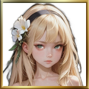](CHANGE_DETAILS_KO.html#portrait-2572) **펠리시티** |  **빌헬미네** |  **야즈민** | 
|  **헬렌** |  **줄리아** | [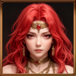](CHANGE_DETAILS_KO.html#portrait-2577) **펠라게야** | [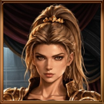](CHANGE_DETAILS_KO.html#portrait-2579) **에게야** | [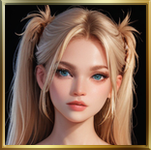](CHANGE_DETAILS_KO.html#portrait-2581) **마리로즈** | [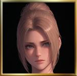](CHANGE_DETAILS_KO.html#portrait-2582) **레이첼** | 
|  **갈라테야** | [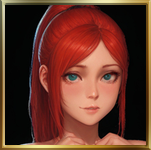](CHANGE_DETAILS_KO.html#portrait-2584) **베네라** |  **뱀피렐라** |  **스네구로치카** |  **캐롤라인** | [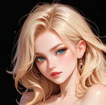](CHANGE_DETAILS_KO.html#portrait-2614) **스네자나** | 
|  **자스민** |  **엘자** |  **루미너스** | [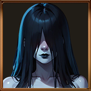](CHANGE_DETAILS_KO.html#portrait-3011) **사다코** |  **샤크티** |  **요르하** | 
|  **다이아나** |  **춘향** |  **일반 노예 #1203** |  **일반 노예 #1447** | [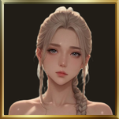](CHANGE_DETAILS_KO.html#portrait-1451) **일반 노예 #1451** | [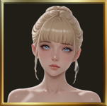](CHANGE_DETAILS_KO.html#portrait-1452) **일반 노예 #1452** | 
| [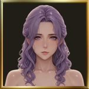](CHANGE_DETAILS_KO.html#portrait-1453) **일반 노예 #1453** | [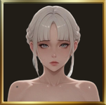](CHANGE_DETAILS_KO.html#portrait-1454) **일반 노예 #1454** | [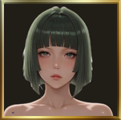](CHANGE_DETAILS_KO.html#portrait-1455) **일반 노예 #1455** | [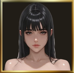](CHANGE_DETAILS_KO.html#portrait-1456) **일반 노예 #1456** | [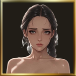](CHANGE_DETAILS_KO.html#portrait-1457) **일반 노예 #1457** | [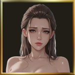](CHANGE_DETAILS_KO.html#portrait-1458) **일반 노예 #1458** | 
| [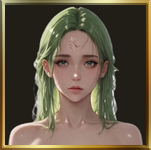](CHANGE_DETAILS_KO.html#portrait-1459) **일반 노예 #1459** |  **일반 노예 #1460** | [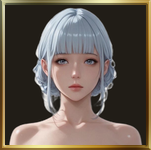](CHANGE_DETAILS_KO.html#portrait-1461) **일반 노예 #1461** | [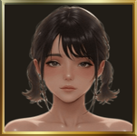](CHANGE_DETAILS_KO.html#portrait-1462) **일반 노예 #1462** | [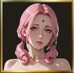](CHANGE_DETAILS_KO.html#portrait-2325) **일반 노예 #2325** |  **일반 노예 #2326** | 
|  **일반 노예 #2327** |  **일반 노예 #2328** |  **일반 노예 #2329** |  **일반 노예 #2330** |  **일반 노예 #2331** | [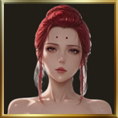](CHANGE_DETAILS_KO.html#portrait-2332) **일반 노예 #2332** | 
| [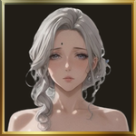](CHANGE_DETAILS_KO.html#portrait-2334) **일반 노예 #2334** | [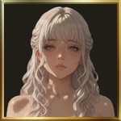](CHANGE_DETAILS_KO.html#portrait-2335) **일반 노예 #2335** |  **일반 노예 #2336** |  **일반 노예 #2337** | [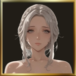](CHANGE_DETAILS_KO.html#portrait-2338) **일반 노예 #2338** |  | 

## 게임시스템

- [고대 로마 배경을 추가하고, 세계·출신·직업에 따른 능력치·성장·특성 배분을 정비했습니다. 공주 출신 일반 인물의 직업도 출신에 맞췄습니다.](CHANGE_DETAILS_KO.html#note--backgrounds)
- [야기슈나를 일반 무작위 등장 대상에서 제외했습니다.](CHANGE_DETAILS_KO.html#note--yagisuna-random)
- [시루와 뱀피렐라에게 여섯 기존 특성을 포함한 뱀파이어 종족 세트를 적용했습니다. 목록 맨 위의 [뱀파이어]를 누르면 세부 특성과 설명을 확인할 수 있습니다.](CHANGE_DETAILS_KO.html#note--vampire-set)
- [유령·안드로이드를 기존 특성을 포함한 종족 세트로 정리했습니다. 뱀파이어·유령·안드로이드에게 각각 종족에 맞는 전투 피해 감소와 면역을 적용했습니다.](CHANGE_DETAILS_KO.html#note--species-sets)
- [석녀에게 애널·펠라 중독, 색정광·정액 중독이 발생하지 않도록 배척 관계와 안내를 보강했습니다.](CHANGE_DETAILS_KO.html#note--stone-exclusions)
- [열흘 단위 장부에서 수입·지출·현물 보상과 결산을 구분하고, 같은 수입이 장부에서 다시 지급되지 않도록 정리했습니다.](CHANGE_DETAILS_KO.html#note--household-ledger)
- [기존 젖소녀 장비의 외형을 일상복으로도 이용할 수 있는 코스튬을 벼룩시장에 추가했습니다.](CHANGE_DETAILS_KO.html#note--cow-costume)
- [끈기·워커홀릭 등 업무 태도와 관련된 성향의 단계를 정리하고, 서로 배척하는 특성의 중복을 보완했습니다.](CHANGE_DETAILS_KO.html#note--work-traits)
- [조수의 업무와 연금술 성과가 일일 헌신 판정에 잘못 반영되던 문제를 수정했습니다.](CHANGE_DETAILS_KO.html#note--assistant-work)
- [이미 보유한 일부 고유 인물의 수정 설정을 갱신할 때 기존 육성과 진행 기록을 보존하도록 보완했습니다.](CHANGE_DETAILS_KO.html#note--owned-profiles)
- [이미 영입한 조커를 다시 구매할 수 있는 것처럼 메뉴가 남던 문제를 수정했습니다.](CHANGE_DETAILS_KO.html#note--joker-repeat)
