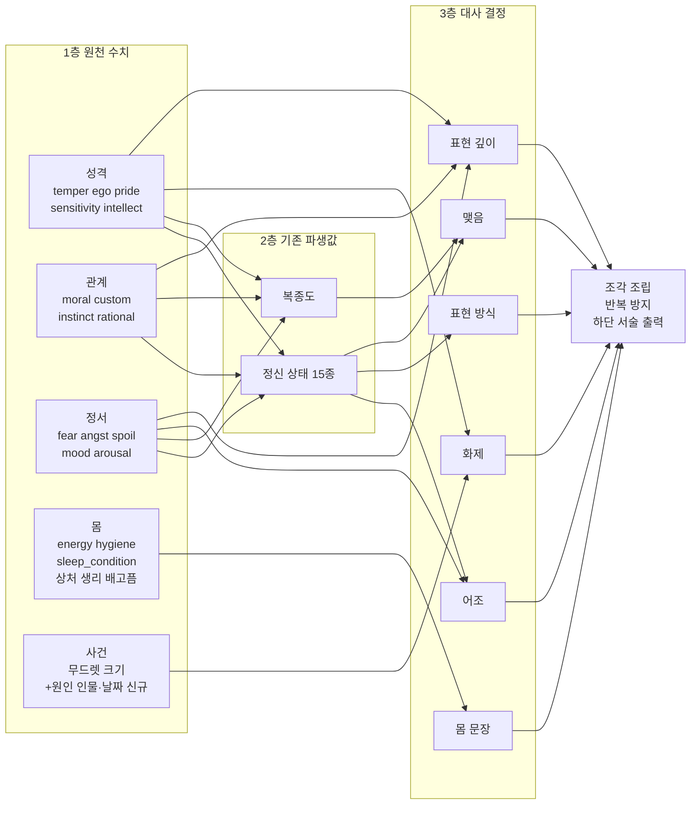

# Wayward → 잭오나 역기획: 노예 반응 체계 변수 매칭 (카일, 2026-10-14)

목적: Wayward의 아내가 "상황에 맞게 말하는" 체계를 잭오나 노예에게 옮기기 전에, 양쪽 설정과 변수를 맞춰 무엇이 이미 있고 무엇이 없는지 정한다.
근거: Wayward 한국어판 index.html(2026-09-30판) 코드, 잭오나 2.4.0.0 QSP(`source/jack_release_2026-10-14_2.4.0.0.qsp`, codex 브랜치), 사용자 제공 노예 정보 화면.
주의: Wayward에는 게임 라이선스 표기가 없다. 구조와 아이디어만 참고하고 코드·문구는 가져오지 않는다.

## 1. 결론
- Wayward는 LLM을 쓰지 않는다. 미리 쓴 문장을 **사건 기억 → 원인 있는 감정 → 아침 상태 → 표현 단계 → 조각 조립(반복 방지)** 순서로 고른다.
- 잭오나는 **재료가 이미 충분하다.** 원인별 감정(무드렛, 밤마다 줄어드는 크기), 성격 수치, 숨은 성향 발견(`*_revealed`), 몸 상태, 정신 상태 15종이 있다.
- 없는 것은 네 가지다.
  1. 감정의 **원인 인물과 날짜**(누가, 언제)
  2. **표현 단계**(속마음을 드러냄/암시/숨김/거짓 표정)
  3. 여러 상태를 묶는 **아침 상태 종합**
  4. **조각 조립과 반복 방지**
- 그래서 지금 출력이 고정 문장이다. 하단 서술은 정신 상태 하나당 한 문장(`$psy_status[...]`)이고, 일기는 무드렛 하나당 한 문장(`$mood_description[...]`)이다.

## 2. 노예 정보 화면 ↔ 변수 (slave_stat에서 확인)
| 화면 | 변수 | Wayward 대응 |
|---|---|---|
| 감수성 | `slave['sensitivity']` | 감정 기복(`volatility`) |
| 성격 (수동적임 등) | `slave['temper']` | 평정(`composure`) |
| 지성 | `slave['intellect']` | 없음 |
| 자아 (단호함 등) | `slave['ego']` | 자신감(`selfConcept.confidence`) |
| 태도 (개방적 등) | `slave['pride']` (표시는 반대 방향) | 개방성(`selfConcept.openness`) |
| 기분 (황홀함 등) | `slave['mood']` | 기분(`dailyState.mood`) |
| 노예의 특성 | `$slave_features_list` | 성격 태그(`traits`, 예: cold_pragmatist) |
| 하단 서술 | `$psy_status[$slave_psy_status]` | 출력 문장. 잭오나는 정신 상태당 고정 1문장 |
| 우측 규칙 패널 (잠자리, 식단, 식사량, 규칙) | 규칙 변수들 | 간접 통제(부추김/제한, `latitude`) |

## 3. 감정 매칭: Wayward 감정 ↔ 잭오나 무드렛
잭오나 무드렛은 노예 배열의 키(`slave['neg_pain']` 등)에 크기를 담고, 밤마다 `$mood_drop`/`$mood_rise`로 줄어든다. Wayward 감정(세기, 원인, 대상, 끝나는 시각)과 같은 역할이다.

| Wayward 감정 | 잭오나 무드렛 (예) | 차이 |
|---|---|---|
| fear (두려움) | `neg_fear`, `neg_pain` | 원인 인물·날짜 없음 |
| shame / humiliation (수치·굴욕) | `neg_shame`, `neg_naked`, `neg_forced` | 〃 |
| anger / contempt (분노·경멸) | `neg_abuse`, `neg_rules`, `neg_spoil`, `neg_no_praise` | 〃 |
| disgust (혐오) | `neg_disgust` | 〃 |
| sadness / numbness (슬픔·무감각) | `neg_angst`, 정신 상태 `broken`/`depresive` | 무감각은 상태로만 있음 |
| pride / elation (자부심·고양) | `pos_praise`, `pos_reward`, `pos_slave_winner` | 〃 |
| tenderness / devotion (애정·헌신) | `pos_gentle`, `pos_slave_love`~`love6` | 〃 |
| ecstasy / desire (황홀·욕구) | `pos_orgasm`, `pos_multiple_orgasm`, `neg_horny` | 〃 |
| guilt / regret (죄책·후회) | `sin`(죄 수치), `pos_no_punish` | 감정이 아니라 수치로 있음 |

## 4. 그 밖의 상태 매칭
| Wayward | 역할 | 잭오나 | 판정 |
|---|---|---|---|
| dailyState (기력, 기분, 몸 상태) | 아침 상태 | `energy`, `stamina`, `mood`, `hygiene`, `sleep_condition`, `neg_exhausted`, `neg_hungry`, `neg_menstruation`, `neg_slave_wounded` | 재료 있음. 묶는 단계만 없음 |
| latentTraits + noticedLatentTraits | 숨은 성향과 발견 | `courage_revealed`, `exhibitionism_revealed`, `deprivation_attitude_revealed` 등 | **같은 구조가 이미 있음** |
| identityStrain | 정체성 갈등 | 직접 대응 없음. 근사: `angst`와 `moral`의 차이 | 필요할 때 계산식으로 |
| trust / comfort | 주인에 대한 신뢰 | **헌신 `moral`**(0~5). 디버그 화면의 "충성심 요소"로 습관·인식·사육이 쌓여 오른다. 천천히 쌓이는 관계 수치라 신뢰와 성격이 같다 | 새 변수 불필요. 정신 상태는 신뢰가 아니다 (8절) |
| notedMoments, topOfMind | 강한 순간 기억, 오늘 마음에 걸리는 일 | 없음. 가장 큰 무드렛으로 대신 가능 | 신규(작게) |
| 대사 반복 방지(cooldown) | 같은 문장 연속 방지 | 없음 | 신규 |

## 5. 사건 매칭: 매일 일어나는 일만 기준으로
손님 접대는 창관 모드 전까지는 특정 이벤트 액션이다. 첫 적용 대상에서 뺀다.

| 잭오나 일상 사건 | 생기는 무드렛 | 빈도 |
|---|---|---|
| 처벌 (`torture_intensity`) | `neg_pain`, `neg_fear`, 처벌 안 함이면 `pos_no_punish` | 높음 |
| 보상·칭찬 (`interaction_reward_level`, `cheer_rate`) | `pos_praise`, `pos_reward`, 없으면 `neg_no_praise` | 높음 |
| 성관계 | `pos_orgasm`, `neg_forced`, `neg_raped` | 높음 |
| 잠자리 (규칙 패널) | `pos_sleep`, `neg_bad_sleep`, `pos_slept_with_master` | 매일 |
| 식사 (규칙 패널) | `pos_cookie`, `neg_slave_food`, `neg_hungry` | 매일 |
| 일·수업 | `pos_job`, `neg_job` | 높음 |
| 청결·옷 | `pos_slave_clean`, `neg_slave_dirty`, `neg_naked`, `pos_clothes` | 매일 |
| 규칙 | `neg_rules` | 매일 |

## 6. 최소 추가안 (설계 방향, 미확정)
1. **원인 기록**: (폐기) 날짜·인물 변수를 새로 두지 않는다. 9절대로 기존 행동 기록 배열의 층(오늘/최근/평생)으로 "언제"를 대신한다.
2. **표현 단계**: 8절 모델을 따른다. 표현 깊이는 헌신(`moral`)과 성격 수치로, 표현 방식은 정신 상태로 정한다. (처음 초안의 "정신 상태로 깊이를 정함"은 폐기)
3. **출력 위치**: 노예 정보 화면 하단 서술. 지금의 정신 상태 고정 문장을 앞에 두고, 가장 큰 무드렛 + 원인 + 몸 상태 조각을 붙인다. 이미 노예 상태를 서술하는 자리라 화면 구성이 바뀌지 않는다.
4. **조각 조립과 반복 방지**: 샘플(QSP 시험 통과)과 같은 방식을 쓴다. 조각 표는 `{when}`/`{who}` 빈칸 표시와 `replace`를 쓴다. QSP 함정은 세 가지다. `$이름`과 `이름`은 같은 변수이고, 문자열 안의 `<<>>`는 대입할 때 계산되며, 한 줄 `elseif`는 안 된다.
5. **세이브 호환**: 새 키가 비어 있으면 지금과 같은 고정 문장이 나오게 한다.

## 7. 사용자 결정이 필요한 것
1. 8절의 변수 상관관계(어떤 변수가 어느 결정에 들어가는지)와 초안 수치
2. 첫 샘플 출력 위치 (초안은 노예 정보 하단 서술)
3. 첫 샘플에 넣을 사건 (초안은 처벌, 칭찬·보상, 잠자리 3종)
4. 구현 담당 (역할상 로컬 도구 또는 Codex)

## 8. 대사 결정 모델: 변수 상관관계 (초안)

### 8.1 원칙
- **층을 나눈다.** 잭오나의 정신 상태와 복종도는 이미 여러 원천 수치를 합친 파생값이다(아래 8.2). 대사 모델은 파생값을 먼저 쓰고, 원천 수치는 파생값이 담지 못하는 뜻에만 쓴다. 같은 수치를 같은 결정에 두 번 세지 않는다.
- **결정 하나에 질문 하나.** 대사는 여섯 개의 결정(어조, 몸, 화제, 깊이, 방식, 맺음)으로 나누고, 결정마다 답하는 질문을 하나로 정한다.
- **우선순위가 있다.** 강한 상태(정신병, 발정, 극심한 피로)는 다른 결정을 덮어쓴다.

### 8.2 이미 있는 파생값 (코드 확인)
| 파생값 | 계산 위치 | 들어가는 원천 수치 |
|---|---|---|
| 복종도 `obedience` | `#static_base` | 두려움×2(+본성 보정), 기분, 헌신×4, 사육×2, 습관, 인식, 절망, 용기, 응석×2(−), 태도·성격·자아·지성(−) |
| 정신 상태 15종 | `#static_base`의 `$newloc_update_slave` | 기분, 헌신, 두려움, 용기, 절망, 응석, 인식, 흥분, 성격·자아·태도, 감수성, 가장 큰 동기(`max_motivation`) |
| 무드렛 크기 | 행동 결과, `next_day` | 사건별. 밤마다 `$mood_drop`/`$mood_rise`로 감소 |

주의: 무드렛 크기의 척도가 제각각이다. `pos_orgasm`은 작은 정수지만 `neg_clothes`는 표시용으로 100이 들어가고, `neg_pony_died`는 최대 100이다. 화제 선택에는 무드렛별 가중치 표가 필요하다.

### 8.3 흐름도

### 8.4 상관 행렬 (● 주 입력, ○ 보정, 빈칸 사용 안 함)
| 변수 | 어조 | 몸 문장 | 화제 | 표현 깊이 | 표현 방식 | 맺음 |
|---|---|---|---|---|---|---|
| 정신 상태 | ● | | | | ● | ○ |
| 복종도 | | | | | | ● |
| 기분 `mood` | ● | | | | | |
| 헌신 `moral` | | | | ● | | |
| 두려움 `fear` | | | | ○ 감춤 쪽 | | |
| 자아 `ego` | | | | ○ 적대 감정은 드러냄 쪽 | | |
| 태도 `pride` | | | | ○ 취약·긍정 감정은 감춤 쪽 | | |
| 성격 `temper` | | | | ○ 적대 감정은 드러냄 쪽 | | |
| 감수성 `sensitivity` | | | ○ 부정 감정 가중 | ○ 긍정 감정은 드러냄 쪽 | | |
| 기력·청결·잠자리·상처·생리·배고픔 | | ● | | | | |
| 흥분 `arousal`, `neg_horny` | | ○ | ○ | | | |
| 무드렛 크기·원인 | | | ● | | | |

### 8.5 진행도 (결정 순서와 규칙)
| 순서 | 결정 | 답하는 질문 | 입력 | 규칙 (초안 수치) | 출력 |
|---|---|---|---|---|---|
| 0 | 덮어쓰기 | 정상 대화가 가능한가 | 정신 상태, 기력 | 정신병(broken)이면 무표정 조각 하나로 끝낸다. 기력 −4 이하면 몸 문장만 쓴다 | 진행 / 종료 |
| 1 | 어조 | 어떤 말투와 온도로 말하는가 | 정신 상태 + 기분 | 정신 상태 15종을 5개 어조로 묶고(아래 8.6), 기분 −5~5를 나쁨/보통/좋음으로 나눈다 | 인사 조각 묶음 |
| 2 | 몸 문장 | 몸이 무엇을 말하는가 | 기력, 청결, 잠자리, 상처·생리·배고픔 무드렛 | 가장 나쁜 하나를 고른다(상처 > 배고픔 > 생리 > 탈진 > 더러움 > 잠자리). 모두 보통이고 숙면이면 개운함 | 몸 조각 하나 또는 없음 |
| 3 | 화제 | 오늘 마음에 가장 걸리는 일은 무엇인가 | 무드렛 크기, 원인 날짜, 감수성 | 점수 = 정규화 크기(0~5) × 무드렛 가중치 × (부정이면 1+감수성/5) + 어제 일이면 1. 최고점 하나 | 감정 묶음 + {who} {when} |
| 4 | 표현 깊이 | 그걸 얼마나 털어놓는가 | 헌신 + 감정 종류별 보정 | 취약(두려움·수치·슬픔): 헌신 − 태도/2 − (두려움≥4면 1) 적대(분노·원망·혐오): 자아/2 + 성격/2 − 두려움 긍정(자부심·애정·고마움): 헌신 + 감수성/2 − 태도/2 값 4 이상 드러냄, 2~3 암시, 1 이하 감춤 | 드러냄/암시/감춤 |
| 5 | 표현 방식 | 감출 때 어떤 모습으로 감추는가 | 정신 상태 | 감춤이면 정신 상태로 모습을 고른다. 두려움·우울·슬픔은 떨림·시선 회피, 혐오감·저항·증오는 거짓 표정, 순응형은 짧은 대답 | 내레이션 조각 |
| 6 | 맺음 | 다음 지시에 어떻게 응하는가 | 복종도, 정신 상태 | 복종도 높음 "시키실 일이 있나요", 보통 침묵, 낮음 거부·회피 조각 | 맺음 조각 또는 없음 |
| 7 | 조립 | | 1~6의 결과 | 순서대로 이어 붙이고, 최근 2일 안에 쓴 조각은 피한다 | 하단 서술 문장 |

### 8.6 정신 상태 → 어조 5종 (초안)
| 어조 | 정신 상태 | 말투 |
|---|---|---|
| 헌신 | servile, obedient, horny | 공손하고 따뜻함 |
| 순응 | docile, soft, optimistic | 공손하지만 조심스러움 |
| 위축 | frightened, depresive, lachrymose, reluctant | 짧고 떨림 |
| 반발 | resistant, arrogant, hateful, hysteric | 존댓말이 무너지거나 날이 섬 |
| 무감 | broken | 거의 말이 없음 |

### 8.7 예시: 사용자 화면의 노예(미스티)로 따라가기
화면 값으로 추정했다. 정확한 수치는 세이브에서 확인해야 한다.
- 정신 상태 노예근성(servile), 기분 황홀함(높음), 성격 수동적임(낮음), 자아 단호함(높음), 태도 개방적(낮음), 감수성 다감함(높음)
- 1 어조는 헌신·좋음이다. "좋은 아침이에요, 주인님."
- 3 화제는 어제 칭찬 무드렛(`pos_praise`)이 가장 크다고 가정한다.
- 4 표현 깊이는 긍정 감정이다. 헌신(높음) + 감수성/2 − 태도/2(낮음) → 드러냄. "어제 칭찬해 주신 거, 계속 생각났어요."
- 같은 노예가 어제 엄하게 처벌받았다면 화제는 두려움이다. 취약 감정이라 헌신 − 태도/2 − 두려움 보정 → 헌신이 높으면 드러냄. "어제 일이 자꾸 떠올라요."
- 같은 처벌이라도 혐오감(arrogant) 노예라면 헌신이 낮아 감춤이 되고, 방식은 거짓 표정이다. "그 정도로 겁먹을 줄 아셨어요?"

### 8.8 아직 정하지 않은 것 (9절 원칙으로 일부 대체)
- 무드렛별 가중치와 정규화 표 (8.2 주의)
- 각 수치의 경계값 (위 수치는 초안)
- 어조 5종 × 기분 3단계 × 감정 9종 × 깊이 3단계에 필요한 조각 수. 처음에는 감정 3종(두려움, 자부심, 피로)만 쓴다

## 9. 기존 변수만으로 동반자 AI 기억 3층 모사 (2026-10-14 원칙)
원칙: 새 상태 변수는 최소로 한다. 잭오나의 기존 변수와 문법으로 동반자 LLM의 기억 구조를 흉내 낸다. 새로 만드는 것은 상태가 아닌 **대사 조각 표(데이터)**와 **조립 함수 하나**뿐이다.

### 9.1 이미 있는 행동 기억 3층 (코드 확인)
| 층 | 기존 변수 | 동작 | 노예 교체 |
|---|---|---|---|
| 단기 | `slave_already_done_today[행동번호]` | 행동할 때마다 +1, 하루 끝(`$end_day_variable_reset`)에 지움 | `$slave_vars`에 있어 따라감 |
| 중기 | `slave_already_done_recent[행동번호]` | 행동할 때 +1, 밤마다 2(1이면 1)씩 줄어듦(`next_day`) | 〃 |
| 장기 | `slave_already_done_total[행동번호]` | 평생 횟수, 줄지 않음 | 〃 |
| (성관계) | `slave_already_sex_today` / `_total` | 오늘·평생 성관계 기록 | 〃 |

`interaction_result`에서 세 배열을 같이 올린다. 조수·젖소 등 다른 인스턴스도 같은 구조다(`assistant_already_done_*`, `cow_already_done_*`).

### 9.2 기억 층 ↔ 기존 변수
| 동반자 AI 기억 | 잭오나에서 대신하는 것 | 대사에서 "언제"의 표현 |
|---|---|---|
| 단기 (지금, 오늘) | `already_done_today`, `slave_rate[...]`(오늘 변화량), `punished_today`, `daily_punishment_count` | "아까", "오늘" |
| 중기 (최근 며칠) | `already_done_recent`, 무드렛 크기(밤마다 감소) | "요즘", "요 며칠" |
| 장기 (평생, 관계) | `already_done_total`, 등급(헌신·습관·인식·사육·두려움 등), `*_revealed`, `beaten_ever`, `$slave_features_list` | "처음에는", "늘", "이제는" |
| 반복에서 생기는 믿음 (성찰) | `recent`·`total`이 기준을 넘는지로 판정 | "요즘 자주 ~하셔서", "늘 ~해 주시잖아요" |
| 누가 | 대부분 주인. 조수 관련은 `sa_` 무드렛과 `$assistant_name`, 상대는 `$interaction_partner` | 이름 |

정확한 날짜("그저께")는 버린다. 층으로 생기는 "아까/요즘/늘"이 동반자 AI의 기억 말투와 더 비슷하고, 변수가 필요 없다.

### 9.3 반복 방지: 기존 의사난수 문법
잭오나는 이미 `((48271 * (day + dynslave_type + interaction)) mod 65537)`로 날짜에 묶인 의사난수를 쓴다(131곳). 조각 번호를 같은 방식으로 고른다.
- 조각 번호 = `((48271 * (day + slave['id'] + 슬롯번호)) mod 65537) mod 조각수`
- 하루 안에서는 같은 말(화면을 다시 열어도 일관됨), 날이 바뀌면 다른 말이 된다. 사용 기록 변수가 필요 없다.

### 9.4 새로 만드는 것 (상태 변수 0개)
| 항목 | 종류 | 기존 문법 |
|---|---|---|
| 행동번호 → 사건 종류 표 (처벌, 칭찬·보상, 성관계, 일, 대화 등) | 데이터 표 | `$mood_description['키']` 같은 키 배열 |
| 대사 조각 표 (어조·몸·화제·깊이·방식·맺음) | 데이터 표 | `#moodlet_base`처럼 데이터베이스 location에 두고 `refresh_database`로 다시 읽음 |
| 조립 함수 | location 하나 | `func(...)` |
| 출력 연결 | 기존 줄 하나 수정 | 노예 정보 하단 서술(`$info_text = $psy_status[...]`) 뒤에 붙임 |

### 9.5 출력 시점 변경
- 아침 대사 대신 **노예 정보 화면 하단 서술**에서 낮 동안 말한다. 아침에는 `today`가 이미 지워져 있고, 하루 한 번 한 일은 `recent`에서도 밤사이 0이 되기 때문이다.
- 낮에 보면 오늘 한 일(단기), 요즘 반복한 일(중기), 평생 관계(장기)를 모두 쓸 수 있다.

### 9.6 한계
- 손님 이름, 정확한 날짜는 남지 않는다. 필요해지면 그때 변수 하나를 검토한다.
- 행동번호 → 사건 종류 표는 행동 수가 많아 만드는 데 품이 든다. 첫 샘플은 처벌·칭찬·보상 계열만 분류한다.

## 10. 대사 출력 자리: 상호작용 메뉴 분류 (2026-10-14)
근거: 2.4.0.0 QSP `interaction`의 행동별 `$interaction_type`(약 470개 행동, 50여 종류)과 메뉴(`menu_form`). 지금은 대부분 3인칭 나레이션이다. 말로 하는 행동(격려 등)의 반응도 "~는 무관심하다" 같은 나레이션이다.

### 10.1 분류 기준
- **A. 대사가 주가 되어야 함**: 주인이 말로 하는 행동이다. 노예의 대답이 행동의 결과 그 자체다.
- **B. 나레이션 + 끝에 한마디**: 몸으로 하는 행동이다. 장면은 나레이션으로 두고, 끝에 노예의 반응 한마디만 붙인다.
- **C. 나레이션 유지**: 장면 묘사가 핵심이거나 노예가 말할 상황이 아니다.

### 10.2 분류표
| 등급 | 행동 종류 (`$interaction_type`) | 행동 수 | 메뉴 위치 | 지금 출력 |
|---|---|---|---|---|
| **A** | `talk`: 질문 7종(과거, 인상, 요구, 희망, 불만, 기분, 조수) + 영향 주기(상황 파악, 격려, 위협, 훈계, 새 호칭) | 15 | 질문하기(111), 영향 주기(112) | 표 조립(인상), 무드렛 목록(기분), 나레이션(격려) |
| **A** | `compliment`: 가볍게 인정, 칭찬, 무게 있는 칭찬, 보상 약속, 선물 약속 | 5 | 보상 메뉴 | `$compliment_description` 나레이션 |
| **A** | `abuse`: 엄하게 꾸짖기, 거칠게 혼내기, 고문·판매·죽음으로 위협 | 6 | 처벌 메뉴 | `$verbal_abuse_description` 나레이션 |
| **A** | `present`: 선물(장신구 등) | 15 | 보상 메뉴 | 나레이션 |
| **A** | `special_talk`: 임신한 노예·조수 돌보기 대화 | 10 | 이벤트 | 고정 문장 묶음 |
| **A** | `talk_assistant`, `assistant_compliment`, `abuse_assistant`: 조수 의견·칭찬·꾸짖기 | 9 | 조수 메뉴 | 나레이션 |
| B | `torture`, `torture_assistant`: 체벌 | 48 | 처벌 메뉴 | 정신 상태 15갈래 나레이션 |
| B | `praise_date`, `praise_sweets`, `praise_erotic`, `rest` 및 조수판 | 약 30 | 보상 메뉴 | 나레이션 |
| B | `master_teaches_slave/assistant`: 주인의 개인 교습 | 39 | 수업 | 나레이션 |
| B | `lecture_slave/assistant`: 관용·비관용 강의 | 16 | 영향 주기 | 주인 강의 나레이션. 끝에 노예 반응 한마디가 어울림 |
| B | `get_drug`(조수판 포함) | 35 | 약물 | 나레이션 |
| C | `self_sex_lesson`(조수판 포함), `rape` | 86 | 성교육·성관계 | 장면 묘사 |
| C | `school_class`, `coach_teaches_slave`, `assistant_teaches_slave` | 42 | 외부 수업 | 주인이 없는 장면 |
| C | `execution`, `branding`, `chestbuster`, `competition`, `make_*_do`, `spell_cast` 등 | 약 40 | 여러 곳 | 장면 묘사 |

### 10.3 A등급 우선순위 (대사가 주가 될 메뉴)
| 순위 | 메뉴 | 이유 |
|---|---|---|
| 1 | **질문하기 7종** | 대답 자체가 목적인 유일한 메뉴. 인상 묻기는 이미 표 조립 구조이고, 기분 묻기는 무드렛(중기 기억)을 그대로 읽는다 |
| 2 | **영향 주기: 격려·위협·훈계·상황 파악** | 하루 1회 행동이라 대답 하나의 무게가 크다. 격려와 상황 파악은 이미 평생 횟수(장기 기억)를 쓴다 |
| 3 | **말로 하는 보상·처벌: 칭찬 5종, 꾸짖기·위협 6종** | 자주 쓰는 일상 행동. 지금은 주인의 말만 나레이션으로 나오고 노예 대답이 없다 |
| 4 | **선물 15종** | 받는 반응이 대사여야 자연스럽다 |
| 5 | 조수 대화·칭찬·꾸짖기, 임신 대화 | 대상이 조수이거나 이벤트성 |

### 10.4 상위 설계에 주는 의미
- 대사 모델(8절)의 출력 자리는 "하단 서술 하나"가 아니라 **A등급 메뉴의 대답**이다. 하단 서술은 그다음이다.
- A등급 행동은 약 60개다. 처음에는 1~2순위(질문하기 7 + 영향 주기 4, 11개)만 다룬다.
- B등급은 같은 모델에서 "끝에 한마디" 슬롯 하나만 쓰므로, A등급 모델이 확정되면 자연히 넓힐 수 있다.

## 11. 사용자 결정 (2026-10-14)
- 대사 출력은 **질문하기 7종에만 먼저 적용**한다(과거, 인상, 요구, 희망, 불만, 기분, 조수에 대해 묻기. 행동 1111~1117).
- 질문하기에서 잘 동작하는 것을 확인한 뒤에 영향 주기, 말로 하는 보상·처벌 등으로 확장을 검토한다.
- 10.3의 2순위 이하는 그때까지 보류한다.
- (추가) **포트레이트를 눌러 여는 노예·조수 정보 화면의 하단 상자**(`$info_text`, `slave_stat`/`assistant_stat`)도 대사 출력 자리로 한다.

### 11.1 포트레이트 화면 하단 상자의 현재 구조 (코드 확인)
하단 상자 하나(`
<<$info_text>>
`)에 상황에 따라 다른 글이 들어간다.

| 경우 | 노예 화면 (`slave_stat`) | 조수 화면 (`assistant_stat`) | 대사화 |
|---|---|---|---|
| 화면을 열 때 기본 | 정신 상태별 3인칭 나레이션 1문장 (`$psy_status[...]`) | **이미 1인칭 대사 형식** `[이름] …` 이지만 늘 같은 문장 1개("새 노예는 혼란을 틈타…") | **대상**. 노예는 3인칭 나레이션 + 1인칭 대사 한 줄, 조수는 전공 보고 내용 유지·말투만 변경 (13.2.2) |
| 규칙·식단·잠자리 칸을 누를 때 | 주인의 명령을 설명하는 나레이션 ("당신은 노예에게 ~하라고 명령한다") | 같음 (`$assistant_cooks_rule` 등) | **대상 아님** (2026-10-14 사용자 결정: 규칙에는 대사 출력이 필요 없다) |
| 능력치 이름을 누를 때 | 능력치 도움말·조언 | 같음 | 대상 아님 (시스템 도움말) |
| 기절·사망 | 상태 나레이션 | 같음 | 대상 아님 |

- 노예 화면은 3인칭 나레이션을 유지하고 조수 화면과 같은 `[이름]` 형식의 1인칭 대사 한 줄을 붙인다(13.2.2).

### 11.2 1차 적용 범위 확정
1. 질문하기 7종 (1111~1117)
2. 포트레이트 정보 화면 하단 상자의 **화면을 열 때 대사** (노예, 조수)
- 규칙·식단·잠자리 칸, 능력치 도움말, 기절·사망 문구는 지금 그대로 둔다.

## 12. 기억 층이 결정하는 것 (초안, 사용자 가설 반영)
사용자 가설: 장기는 일관된 태도, 중기는 어투, 단기는 사건 서술.
검토 결과 큰 틀은 맞다. 다만 "어투"를 둘로 나눠야 한다. **말씨**(존댓말·호칭·격식)는 쉽게 바뀌지 않으니 장기에, **감정의 온도**(밝음·가라앉음·날 섬)는 며칠 단위로 바뀌니 중기에 둔다.

### 12.1 층별 역할
| 층 | 결정하는 것 | 잭오나 변수 | 대사에서 보이는 모습 |
|---|---|---|---|
| **장기** | 정체성과 태도: 주인을 어떻게 대하는가, 말씨, 얼마나 털어놓는가 | 정신 상태(기본값 `psy_basic`), 헌신·습관·사육·인식 등급, 성격·자아·태도, 노예의 특성, 발견된 성향, 겸손 규칙(`humility_rule`), 평생 횟수(`already_done_total`) | 같은 노예는 어떤 날에도 같은 사람처럼 말한다. 헌신적인 노예는 아파도 공손하고, 적대적인 노예는 기분이 좋아도 날이 서 있다 |
| **중기** | 감정의 온도와 요즘 화제: 어떤 기분으로 말하는가, 요즘 무엇이 마음에 걸리는가 | 기분(`mood`), 무드렛, 최근 횟수(`already_done_recent`) | 같은 말씨라도 밝거나 가라앉는다. "요즘 자주 ~" 같은 반복된 일과 믿음 |
| **단기** | 구체 사건과 몸, 순간 반응 | 오늘 횟수(`already_done_today`), 오늘 변화량(`*_rate`), `punished_today`, 기력·청결·배고픔 | "아까 ~" 같은 구체 언급, 몸 상태 한마디, 방금 일에 대한 흔들림 |

### 12.2 층 사이의 규칙
- **장기는 틀이다.** 중기와 단기는 그 틀 안에서만 흔든다. 단기 사건이 장기 태도를 뒤집지 않는다. 동반자 AI에서 페르소나(장기)가 최근 대화(단기)보다 위에 있는 것과 같다.
- **표현의 우선순위는 단기 > 중기 > 장기다.** 방금 일어난 일이 있으면 그것을 먼저 말하고, 없으면 요즘 일, 그것도 없으면 평소 태도를 드러낸다.
- **단기의 일시 덮어쓰기는 이미 잭오나 문법에 있다.** 처벌 직후 텍스트 선택용으로 정신 상태를 잠깐 바꾼다(`#dynamic`의 "temporary status change for better text selection"). 같은 방식으로 단기 반응을 표현한다.

### 12.3 8절 대사 결정과의 대응
| 대사 결정 | 주로 쓰는 층 |
|---|---|
| 어조 | 장기(말씨) + 중기(온도) |
| 몸 문장 | 단기 |
| 화제 | 단기 → 없으면 중기 → 가끔 장기(회상) |
| 표현 깊이 | 장기 (헌신 등) |
| 표현 방식 | 장기(정신 상태) + 단기(일시 덮어쓰기) |
| 맺음 | 장기 (복종도) |

### 12.4 예시 (사용자 화면의 두 노예)
- 미스티: 장기는 노예근성·헌신 높음이라 공손한 1인칭이다. 중기는 기분 황홀함이라 밝은 온도다. 단기에 아까 칭찬을 받았다면 "아까 칭찬해 주셔서 아직도 들떠 있어요, 주인님."
- Galateya: 장기는 증오·태도 당당함이라 날 선 말씨이고, 털어놓는 깊이가 얕다. 중기는 기분 부정적이라 가라앉고 거친 온도다. 단기에 아까 처벌을 받았다면 숨기고 거짓 표정을 짓는다. "그 정도로 제가 꺾일 줄 아셨어요?"

### 12.5 말투 원칙 (2026-10-14 사용자 결정)
- 잭오나 세계관에서 노예·조수가 주인에게 반말을 하는 것은 매우 극단적인 상황이다.
- **일상 대사(조각 조립)는 존댓말만 쓴다.** 말투는 노예·조수 역할로 나누지 않는다(즉시 교체되므로 말투가 계속 바뀌게 된다). 12.6대로 출신·직업에 따라 정한다.
- 적대·반발은 반말이 아니라 **내용과 비꼬는 존대**로 표현한다. 예: "그 정도로 제가 꺾일 줄 아셨어요?"
- **반말은 특정 사건의 통 대사(이벤트 처리)로만** 쓴다. 조립 대상이 아니며, 사건이 끝나면 일상 존댓말로 돌아간다.
- 따라서 조각 표는 말투별로 곱하지 않는다. 한국어 조립 규칙은 다음만 지킨다.
  1. 조각은 문장 끝까지 갖춘 완결 문장으로 쓰고, 문장끼리만 이어 붙인다.
  2. 어미 자동 변환은 쓰지 않는다.
  3. 주어 높임이 얽히는 문장은 줄이고 주어 생략 문장을 기본으로 한다.
  4. 조사는 잭오나 기존 표기("(은)는", "이(가)")를 따른다.
- 참고: 2026-10-14 체험용 샘플(아티팩트)의 "복종 낮음 = 반말" 인사 조각은 이 원칙과 맞지 않는다. 샘플을 다시 쓸 때 고친다.

### 12.6 말투는 역할이 아니라 출신·직업으로 (2026-10-14 사용자 방향, 초안)
잭오나에는 노예마다 평생 고정된 배경 변수 세 개가 있다. 노예 생성(`generate_stock`) 때 정해지고, 노예 교체 목록(`$slave_vars`)에 있어 노예·조수를 바꿔도 따라간다. "과거 묻기"(1111)가 이 세 설명을 출력한다.

| 변수 | 종류 수 | 예 |
|---|---|---|
| `$slave_world` 출신 세계 | 13 | prehistoric, barbarian, medieval, highfantasy, darkfantasy, steampunk, industrial, modern, cyberpunk, space 등 |
| `$slave_family` 가족 배경 | 54 | knight, mprincess, merchant, pesant, orphan, servant, clerk, mafiosi, magnat 등 |
| `$slave_occupation` 직업 | 58 | maid, secretary, nun, teacher, student, thief, thug, punk, witch, policewoman, noble_wife 등 |

- 대사 속 "검투사"는 직업 값이 아니라 **전공**(`slave_specialisation`: servant, gladiatrix, concubine, pet, artist, refferent 등)이나 기술에서 나온다. 전공은 훈련으로 바뀌므로 말투의 근거로는 배경 세 변수가 더 맞다.
- 초안: 직업·가족을 몇 개의 **말투 군**으로 묶는다. 모두 존댓말이다.
  - 격식 군 (하녀, 비서, 수녀, 귀족 가문 등): 합니다체
  - 일반 군 (학생, 교사, 상인 가문 등): 해요체
  - 투박 군 (도적, 불량배, 부족, 농민 등): 해요체 + 거친 어휘
- 조각 수를 늘리지 않는 방법: 한국어에서 합니다체와 해요체는 한 사람의 말 안에서 섞여도 자연스럽다. 그래서 **본문 조각은 해요체 한 벌을 공유하고, 인사·맺음·호칭 조각만 말투 군별로 둔다.** 하오체처럼 해요체와 섞으면 어색한 말투는 쓰지 않는다.
- 출신 세계(13)는 말투보다 어휘(예: 현대·사이버펑크의 외래어)에 쓰는 것을 검토한다.

### 12.7 말투 확정 (2026-10-14 사용자 결정)
- Wayward의 4종(해·해요·하게·하오)은 손님이 아내에게 하는 말투라 그대로 쓰지 않는다. 하게·하오는 노예가 주인에게 쓰면 내려다보거나 건방진 말이 된다.
- **하옵니다체(궁중 극존칭)는 제외한다.**
- 일상 대사 말투는 세 가지로 한다. 모두 올려 말하는 존댓말이다.
  | 말투 | 성격 | 예 (어제 칭찬받은 뒤 기분 묻기) |
  |---|---|---|
  | 합니다체 (격식) | 정중하고 딱딱함 | "어제 칭찬해 주셔서 기뻤습니다, 주인님." |
  | 해요체 (일반) | 부드러운 존댓말, 기본값 | "어제 칭찬해 주셔서 기뻤어요, 주인님." |
  | 투박한 해요체 | 존댓말이지만 거친 어휘 | "어제 칭찬해 주신 거, 솔직히 좀 좋았어요." |
- **귀족 가문 하인·궁정 출신은 말투(어미)는 위 셋 중 하나를 쓰되 어휘를 다르게 한다.** 예: "칭찬해 주셔서" 대신 "치하해 주셔서", "기뻤어요" 대신 "영광이었어요". 어휘 차이는 어휘 조각(낱말 바꿈 표)으로 처리하고, 어미는 바꾸지 않는다.
- 반말은 12.5대로 사건 통 대사 전용이다.

### 12.8 배경 변수 → 말투·어휘 배정 (초안, 2026-10-14 사용자 승인 방향)
원칙: **직업(`$slave_occupation`)으로 말투 3종을, 가족 계층(`family_index`)으로 어휘를 정한다.** 새 변수는 없다.

#### 가족 (`$slave_family`, 54종)
- 생성 순서: 출신 세계(13) → 세계별 가족 후보 묶음(`$<세계>_family`) → 가족.
- 가족마다 계층 값 `family_index`(1~5), 능력치 보정, 이름표(`$stock_family_auk`, 예 "상인의 딸"), 1인칭 과거 이야기(`$family_description`)가 붙는다.

| family_index | 가족 |
|---|---|
| 1 왕가 | barbarian_king(야만족 왕가), mprincess(공주) |
| 2 상류 | knight(영주), magnat, bankeer, mayor, mafiosi, surgeon, businessman, finance, general, astrofarm, nanofarmacist |
| 3 중류 | viking, craftsman, merchant, farmers, clerk, naturalist, ingeneer, doctor, servant(부잣집 하인), manager, biologist, programmer, poet, operator, artist, architect, freetrader, astrogator, admiral, gendesigner |
| 4 서민 | pesant, hunter, fisher, bondman, valetry(하녀 집안), proletarian, worker, jailer, bioreactor, asteroid |
| 5 최하·외부 | tribe, amazon, nomad, orphan, gypsy, church, workhouse, orpnange, minitruth, anter |
| **54 (버그)** | policeman |

주의: policeman은 5가 아니라 **54**다. 12.9 참고.

#### 직업 (`$slave_occupation`, 58종)
- 생성 순서: 가족별 직업 후보 묶음(`$<가족>_occupation`) → 직업. 어린 나이(`loli_age`)는 직업이 없다.
- 직업마다 노동 계층 `work_index`(2~5), 기술 보정(예: maid는 service·custom, secretary는 expression·secretary·service), 이름표, 설명이 붙는다.

#### 말투 배정 초안 (직업 기준)
| 말투 | 직업 |
|---|---|
| **합니다체** (격식) | maid·valertry(하녀), secretary(비서), nun(수녀), policewoman(경찰), mind_contol(정신 지배 경찰), time_plice(시간 경찰), jailer(교도관), academy(스타플릿 졸업생), mech(전투 로봇 조종사) |
| **투박한 해요체** | tribal_girl(부족 소녀), thief(도둑), beggar(거지), gypsy(점쟁이), whore·markitane·brothel(창녀), thug(노상강도), brigand(산적), punk(펑크), contraband(밀수업자) |
| **해요체** (기본) | 나머지 전부 (학생, 교사, 간호사, 웨이트리스, 작가, 예술가, 모델, 운동선수, 해커, 농사·직조 노동, 마녀·샤먼·약초사·마법사 제자, 영웅 여전사, 신부·아내 계열, 여왕의 딸 등) 및 직업 없음 |

#### 어휘 배정 초안 (가족 기준)
| 어휘 | 가족 |
|---|---|
| **궁정·귀족가 하인 어휘** (사용자 지정) | 궁정: mprincess, knight / 귀족가 하인: valetry, servant |
| 세련된 어휘 | 그 밖의 family_index 2 (상류) |
| 보통 어휘 | family_index 3·4 |
| 거친 어휘 | family_index 5 중 tribe, amazon, nomad, gypsy, workhouse, orphan, orpnange, anter (policeman, minitruth, church는 보통 어휘) |

- barbarian_king(야만족 왕가)은 계층 1이지만 궁정 어휘가 아니라 거친 쪽이 맞는지 판단이 필요하다.
- 말투와 어휘는 따로 정해져 조합된다. 예: 하녀 집안(valetry 가족) + 하녀 직업 = 합니다체 + 귀족가 하인 어휘.

#### 발견한 원본 데이터 문제 (참고, 수정은 로컬 담당)
- 직업 후보 묶음에 번역된 값이 섞여 있다: `$orphan_occupation`의 '창녀', `$orpnange_occupation`의 '창녀'·'매춘굴'. 원래 'whore'·'brothel'이어야 하며, 이 값이 뽑히면 직업 처리(능력치·설명)가 빠진다.
- `$barbarian_king_occupation`의 'barbarian_princess'는 직업 처리 분기가 없다.

### 12.9 사용자 결정과 확인 결과 (2026-10-15)
1. 야만족 왕가(barbarian_king): **거친 어휘**.
2. 간호사·교사·웨이트리스: **해요체** (초안 유지).
3. 계층 5의 경찰·관료 집안 → 조사 결과
   - **policeman(경찰관의 딸)의 `family_index`는 54다. 버그(오타)로 판단한다.**
     - 한국어판 순정 2.3.2.5에도 54로 들어 있다. 우리 패치가 만든 것이 아니다.
     - gitgud 영어 원본(`game-base` master-ia-patch, master)에는 `family_index`와 노예·조수 관계 계산(`origins_relations`, 러시아어 주석 "mrross")이 아예 없다. 이 계층 값과 관계 계산은 한국어판 계열에 따로 들어온 코드이고, 54도 그때 생긴 것으로 보인다.
     - 이 값은 노예·조수 관계 점수에 쓰인다. 계산은 1~5만 가정한다. 54면 상대가 왕가·상류·중류일 때 관계 점수가 −51·−50·−49, 최하층일 때 +48이 되고, 경찰 집안 노예 쪽에서 보면 해당 분기가 없어 가족 관계 문장이 빠진다.
     - 같은 현대 세계 가족이 worker 4, manager 3, orpnange 5인 것으로 보아 의도는 4로 추정한다. 확정은 아니다.
     - **사용자 결정(2026-10-15): 세계관 설정에 맞춰 4로 수정한다.** main에 `mods/2026-10-15_policeman_family_index_fix.json`(커밋 4e98bbe)으로 전달했다. 새로 생성되는 노예에만 적용되고, 이미 세이브에 있는 노예의 54는 남는다. 대사 설계에서는 경찰 집안을 계층 4(보통 어휘)로 취급한다.
   - **minitruth(진리부 관료의 딸) 5는 설정으로 본다.** 값이 정상 범위이고, 전체주의 미래 세계의 가족 네 개가 모두 4~5(jailer 4, bioreactor 4, minitruth 5, anter 5)다. 이 세계에서는 관료 집안도 낮은 계층으로 설계한 것으로 보인다. 어휘는 계층대로 거친 어휘 대상에 넣지 않고 보통 어휘로 둔다(12.8 유지).

## 13. 1차 적용 범위 상세 설계 (초안, 2026-10-15)
원칙: 지금 나오는 내용은 버리지 않고, 기억 층(12절)으로 **앞뒤를 감싸거나 고르는 방식**으로 바꾼다. 말투는 직업, 어휘는 가족 계층(12.6~12.8)을 따른다.

### 13.1 거부 (지금 그대로 둔다)
- 질문마다 거부 수치가 다르다. 과거 묻기가 가장 어렵고(3 + 태도), 인상 묻기가 가장 쉽다(−10). 복종이 모자라면 거부한다.
- 거부하면 정신 상태별 1인칭 통 대사 15종(`$refuse_talk`) 중 하나가 나오고, 노예에게 죄책이 쌓여 처벌할 수 있게 된다.
- 이 대사는 이미 사건성 통 대사라 12.5 원칙(반말은 통 대사로만)과 맞는다. 증오심 상태의 반말 거부도 그대로 둔다.
- 조립 대사는 **거부하지 않았을 때만** 쓴다.

### 13.2 질문 7종
| 질문 | 지금 게임에서 | 바뀐 뒤 | 쓰는 기억 층 | 표현 깊이 |
|---|---|---|---|---|
| 과거 묻기 | 출신 세계·가족·직업 고정 이야기 3문단 | 이야기는 그대로 두고 앞뒤에 한마디: 기분이 나쁘면 "돌아가고 싶다", 헌신이 높으면 "지금은 여기가 제 자리예요" | 장기(이야기, 태도) + 중기(기분) | 헌신이 낮으면 짧게 끊는다 |
| 인상 묻기 | 등급별 표 9개에서 한 줄씩 조립. 복종이 낮으면 일부 줄을 숨김 | 그대로 두고 **요즘 주인이 한 일** 한 줄을 더함: 요즘 자주 칭찬함 / 자주 처벌함 / 오늘 무엇을 했음 | 장기(등급) + 중기(최근 횟수) + 단기(오늘) | 지금의 "복종이 낮으면 숨김"이 곧 표현 깊이. 헌신 기준으로 맞춘다 |
| 요구 묻기 | 욕구·성향 목록(편안함, 사치, 단것 등) | 그대로 두고 **지금 몸이 원하는 것**을 앞에 둠: 배고픔 → 먹을 것, 더러움 → 씻고 싶음, 잠자리 나쁨 → 침대 | 장기(욕구) + 중기·단기(몸 상태 무드렛) | 헌신이 낮으면 요구를 말하지 못하고 돌려 말한다 |
| 희망사항 묻기 | 기술 적성 14종(운동, 화술, 애완, 승마, 젖소, 간호, 잡일, 요리, 전투, 마법, 미술, 음악, 체조, 비서) 중 적성이 있는 일을 "이런 일을 하고 싶다/잘할 것 같다"로 말함. 없으면 정신 상태로 "명령대로 하겠다" 등 | **장기 육성 방향**. 적성에 대한 의사표시는 기본으로 넣되, 성격과 수업 방식에 따라 달라진다. **세부 기획 필요 (13.5)** | 장기(적성) + 수업 방식 | 13.5에서 정함 |
| 불만 묻기 | 싫어하는 성향 목록 | 그대로 두고 **요즘 쌓인 불만**을 더함: 규칙, 칭찬 없음, 욕설, 싫은 일, 오늘 처벌 | 장기(성향) + 중기(나쁜 무드렛) + 단기(오늘) | 분노 계열 공식: 자아·성격이 높고 두려움이 낮아야 말한다. 두려우면 "괜찮아요"로 감춘다 |
| 현재 기분 묻기 | 무드렛 문장을 **전부 나열** | **지금 틀(전부 나열)을 유지**하고, 말투만 직업에 맞춤 (13.2.2-1) | 중기(무드렛) | 지금처럼 |
| 조수에 대해 묻기 | 관계 점수와 배경 비교 문장 | 그대로 두고 **요즘 조수와 있었던 일**을 더함: 질투, 같이 잔 일, 싸움 무드렛 | 장기(관계 점수) + 중기(조수 관련 무드렛) | 질투·원망은 분노 계열 공식 |

### 13.2.1 요구 묻기와 희망사항 묻기의 차이 (실제 대사 확인, 2026-10-15)
- **요구 묻기(1113)**: 지금 생활에서 바라는 것. 편안함(잠자리·가구), 사치(드레스·보석), 단것(케이크), 명성(도시 나들이·친구), 체벌·어둠·피 등 성향 욕구, 성욕. 예: "좀 더 편한 잠자리가 있었으면 좋겠어요." 없으면 "전 감히 어떤 것도 요구할 수 없어요, 주인님."
- **희망사항 묻기(1114)**: 하고 싶은 일·잘할 것 같은 일. 기술 적성 14종에서 나온다. 예: "전 언제나 싸울 준비가 됐어요… 유명한 검투사가 될 거에요!", "개인비서가 저에게 가장 잘 맞는 일 같아요." 없으면 "주인님이 명령하시는 거라면 뭐든지 할 준비가 되어 있습니다."
- 결론: 요구는 **지금의 생활 욕구**(중기·단기와 맞음), 희망사항은 **장기 육성 방향**이다.

### 13.2.2 사용자 결정 (2026-10-15)
1. **현재 기분 묻기는 지금 틀(무드렛 문장 전부 나열)을 유지한다.** 1~2개 선택으로 바꾸지 않는다.
2. **노예 포트레이트는 지금의 3인칭 나레이션을 유지하고, 그 뒤에 1인칭 대사 한 줄을 붙인다.** (2026-10-15 정정: 앞서 "3인칭 한 줄 추가"로 적은 것은 오해였다.) 대사 한 줄은 기억 층(오늘 일 → 요즘 일 → 평소)으로 고른다.
3. **조수 포트레이트는 대사 조합을 하지 않는다.** 지금과 같은 **노예 전공 정보 보고**("노예의 전공을 알아본 결과 다음과 같습니다" + 충족한 전공 목록 + 상표 없음 안내, 노예가 없을 때의 기본 보고)를 그대로 말하고 **말투만 조수의 직업에 맞게 바꾼다.**

### 13.3 포트레이트 화면을 열 때의 대사 (13.2.2로 갱신됨)
- 질문 없이 먼저 거는 그날의 한마디다. 거부는 없다. 정신병(broken)이면 말 없이 행동 묘사만 나온다.
- 말할 거리 순서는 12.2대로 한다: 오늘 일(단기) → 요즘 일(중기) → 평소 태도(장기).
- **노예 화면**: 지금의 정신 상태 3인칭 묘사 한 문장을 앞에 두고, 그 뒤에 `[이름]` 1인칭 대사 한 줄을 붙인다(예: 3인칭 "그녀는 당신의 눈치를 살핀다." + `[이름]` "오늘은… 더 조심할게요.").
- **조수 화면**: 조립하지 않는다. 지금의 노예 전공 보고 문장(`assistant_stat`의 기본 보고, 전공 보고, 상표 안내)을 내용 그대로 두고, 합니다체·해요체·투박한 해요체 세 판을 두어 조수의 직업으로 고른다. 예: 합니다체 "노예의 전공을 알아본 결과 다음과 같습니다, 주인님." / 해요체 "노예 전공을 알아봤더니 이래요, 주인님." / 투박한 해요체 "애 전공 알아봤는데요, 이래요."

### 13.4 정할 것
- 13.5.1 문턱값과 상태 이름 확인.
- 수업 방식별 의사표시 문장(13.5 결정 1)과 성격 상태(13.5.1)를 어떻게 겹칠지.

### 13.5 희망사항 의사표시 세부 기획 (2026-10-15)
사용자 결정: 적성에 대한 의사표시는 기본으로 반영한다. 다만 **성격**과 **수업 방식**에 따라 달라질 수 있으므로 세부 기획이 필요하다.

게임에 있는 수업 방식 (코드 확인, `menu_form`·`interaction`·`#dynamic`)
| 메뉴 | 사용자 명칭 | 누가 가르치나 | 내부 구분 (`$interaction_type`) | 수업 번호 예 | 성실도 보너스 | 거부 |
|---|---|---|---|---|---|---|
| 교육 활동 (`menu_lesson`) | 직접교육 | 주인 | `master_teaches_slave` | 1211 | 주인 교육 능력 B+ 이상에서 +1~+3 | 거부할 수 있음 |
| 가정교사 (`menu_tutor`) | 가정교사 | 돈 내고 부른 교사 | `coach_teaches_slave` | 1711 | +3 | 거부할 수 없음 |
| 학과 출석 (`menu_classes_S`) | **위탁교육** (2026-10-15 사용자 확인) | 도시의 학과 | `school_class` | 561 | +2 | 거부할 수 없음 |
| 조수⇒노예 : 교육 (`menu_lesson_S_A`) | (조수 교육) | 조수 | `assistant_teaches_slave` | 4111 | 조수 지성 A+ 이상에서 +1~+2 | 거부할 수 있음 |

- 수업마다 방식별로 번호가 따로 있으므로, `slave_already_done_today/recent/total[번호]`로 **어떤 기술을 어떤 방식으로 얼마나 배웠는지**를 새 변수 없이 알 수 있다.
- 가정교사와 학과는 거부할 수 없다(`#dynamic`: "when refusal is not possible (tutor, academy)"). 싫어도 끌려가 배운 경험이 된다.

사용자 결정 (2026-10-15)
1. 수업 방식별로 의사표시를 다르게 한다 (직접교육 = 주인에 대한 감정, 가정교사 = 교사 이야기, 위탁교육 = 바깥 학과 이야기, 조수 교육 = 조수와의 관계).
2. 성격은 **성격·자아·태도·감수성 네 값의 복합으로 상태를 정의**한다. 새 변수는 만들지 않고 **계산식**으로 정의한다.
3. 관심 없거나 싫은 과목을 배웠을 때의 반응은 기존 수업 결과 대사의 분기 값을 파악해 만든다. 조합을 늘리지 않고 **말투별 구분만** 둔다.

#### 13.5.1 성격 복합 상태 (계산식, 제안)
네 값은 모두 0~5다 (태도 `pride`는 높을수록 건방짐·오만함).
- **드러냄** = 성격 `temper` + 감수성 `sensitivity` (0~10): 감정이 얼마나 겉으로 나오는가.
- **내세움** = 자아 `ego` + 태도 `pride` (0~10): 자기 뜻을 얼마나 앞세우는가.
- 7 이상 = 높음, 3 이하 = 낮음, 그 사이 = 보통.

**2026-10-15 결정: 이 절의 5상태 표는 14.4의 기획용 유형 9종으로 대체한다.** 희망사항 의사표시는 14.6의 유형별 항목을 따른다.

| 희망사항 의사표시 예 (해요체) | 유형 |
|---|---|
| "전 검투사가 될 거예요. 시켜 주세요!" | 불꽃 |
| "…검투라면 제가 제일 잘할 거예요. 그뿐이에요." | 얼음 |
| "저기… 사실은 그림을 배워 보고 싶어요." | 여린 |
| "명령하시는 대로 할게요… 요리라면 조금 할 수 있어요." | 순종 (인형은 더 짧게) |
| 지금의 게임 문장 그대로 | 평범 |

- 계산식은 대사를 고르는 순간에만 쓰고 저장하지 않는다.
- 문턱값(7, 3)은 실제 노예 분포를 보고 조정할 수 있다.

#### 13.5.2 관심 없거나 싫은 과목을 배웠을 때의 반응
- **기존 분기 값**: 수업 결과 대사는 `interaction_slave['diligence']`(성실도, 0~5)로 갈린다 (`interaction_result`).
  - 학과(위탁): `$school_end[성실도]` (성적표 장면)
  - 가정교사: `$jeeves_diligence[성실도]` 등 교사별 배열
  - 조수 교육: `$assistant_lesson_diligence[성실도]`
- 성실도에는 그 과목 적성이 크게 들어간다 (`#dynamic` `$dyn_diligence`: 적성 있음 +10, 적성 싫음 −10). 그래서 싫은 과목은 거의 늘 매우 낮은 등급 대사가 나온다.
- **반응 대사 조건**: 수업을 거부하지 않았고(`res >= 0`), 그 과목 적성이 0 이하이며(`slave[$target_affinity] <= 0`), 성실도가 0~1일 때.
- **출력 위치**: 기존 결과 대사 바로 뒤에 노예의 1인칭 한 줄.
- **대사 수**: 말투 3종만 둔다 (방식·과목·성격 조합 없음).
  - 합니다체: "…이 공부는 저와 맞지 않는 것 같습니다."
  - 해요체: "…솔직히 이건 재미없었어요."
  - 투박한 해요체: "…이런 거 배워서 뭐 해요."

## 14. 노예 유형 정의 (초안, 2026-10-15)

### 14.1 사용자 원칙
- MBTI는 분류 체계를 생각해 보기 위한 예시였을 뿐 따라 할 필요는 없다.
- 잭오나의 노예는 계속 변하고, 같은 값 안에도 단계가 있다. 유형은 고정된 상자가 아니어야 한다.
- 이 구조는 대사 수를 정하려는 것이 아니라 **노예의 유형을 어떻게 정의할 것인가**의 문제다.

### 14.2 게임의 실제 구조 (코드 확인, `#variative`·`#static_base`)
- 성격·자아·태도·감수성(및 지성·습관·헌신·불안·응석·본능·이성·공포)은 0~5 **등급**과, 등급 안의 **진행도**(`slave_rate[...]`)를 가진다.
- 플레이 중의 일이 진행도를 올리거나 내리고, 문턱을 넘으면 등급이 한 칸 바뀌며 진행도는 0으로 돌아간다.
- 문턱은 등급이 높을수록 멀다.

| 현재 등급 | 0 | 1 | 2 | 3 | 4 | 5 |
|---|---|---|---|---|---|---|
| 오르는 문턱 | 10 | 20 | 40 | 80 | 160 | — |
| 내리는 문턱 | — | −10 | −10 | −20 | −40 | −80 |

- 즉 **높은 등급일수록 굳어서 잘 안 바뀌고, 낮은 등급은 쉽게 흔들린다.**

### 14.3 사용자 결정 (2026-10-15)
- 14.2의 구조(등급·진행도·굳기)에는 동의한다.
- 다만 기획할 때 모든 값의 진행도를 파악해 매번 정의하기는 어렵다. **노예 유형은 게임 변수가 아니라 기획에 반영하기 위한 정의**로 만든다.
- 따라서 유형은 보이는 등급만으로 대략 판정하고, 진행도는 기획 판단(이 유형은 무엇에 흔들리는가)으로만 반영한다.

### 14.4 기획용 노예 유형 9종 (초안)
- 판정에 쓰는 값: 화면에 보이는 성격·감수성·자아·태도 등급(0~5)만.
- **드러냄** = 성격 + 감수성, **내세움** = 자아 + 태도 (13.5.1과 같음). 0~3 낮음, 4~6 보통, 7~10 높음.
- 정신 상태(15종)는 그날의 상태이고, 유형은 그보다 긴 성격이다. 같은 유형도 정신 상태에 따라 그날 모습이 다르다.

| | 드러냄 낮음 | 드러냄 보통 | 드러냄 높음 |
|---|---|---|---|
| **내세움 높음** | **얼음**: 차갑고 오만하다. 말이 짧고 속을 보이지 않는다 | **도도**: 자존심이 세고 말로 선을 긋는다 | **불꽃**: 거침없이 맞서고 감정이 터진다 |
| **내세움 보통** | **관조**: 담담하고 거리를 둔다. 시키면 하지만 마음은 따로 있다 | **평범**: 무난하다. 상황에 따라 흔들린다 | **솔직**: 감정이 얼굴에 드러나고 할 말은 한다 |
| **내세움 낮음** | **인형**: 감정도 의지도 옅다. 대답만 한다 | **순종**: 조용히 따른다. 작은 것에 기뻐한다 | **여린**: 수줍고 잘 운다. 정에 약하다 |

유형마다 기획에 적어 둘 항목
| 항목 | 뜻 | 예 (불꽃) |
|---|---|---|
| 말하는 결 | 같은 말투(12절) 안에서의 태도 | 짧고 세게, 반문이 많다 |
| 드러내는 것 | 무엇을 쉽게 말하는가 | 불만, 분노, 원하는 것 |
| 감추는 것 | 무엇을 말하지 않는가 | 두려움, 약한 모습 |
| 흔들리는 계기 | 어떤 일로 다른 유형으로 옮겨 가는가 (진행도 대신 기획 판단) | 거듭된 처벌로 내세움이 꺾이면 솔직이나 여린 쪽으로 |

- 높은 등급일수록 굳는다는 14.2의 사실은 "극단 유형(네 모서리)은 잘 안 바뀌고, 가운데 유형은 쉽게 옮겨 간다"로 기획에 반영한다.

### 14.5 결정 (2026-10-15)
1. 9종의 이름과 경계(0~3 / 4~6 / 7~10)를 확정한다.
2. 9종 모두 기획 항목을 채운다 (14.6).
3. 13.5.1의 5상태 표를 이 9종으로 대체한다.
- 경계에 따른 실제 노예 분포는 아직 확인하지 않았다 (한 유형에 몰리는지 나중에 확인).

### 14.6 유형별 기획 항목
| 유형 | 말하는 결 | 드러내는 것 | 감추는 것 | 흔들리는 계기 |
|---|---|---|---|---|
| 얼음 | 짧고 건조하다. 대답은 하지만 덧붙이지 않는다 | 경멸, 무관심, 자기 능력 | 감정 전부, 특히 외로움 | 잘 안 바뀜. 선물·단것·휴식이 이어지면 감수성이 올라 도도로. 성행위 강요·강간이 거듭되면 태도는 꺾이고 감수성은 더 메말라 관조나 인형으로 |
| 도도 | 예의는 지키되 말로 선을 긋는다. 조건을 붙인다 | 자존심, 취향, 불쾌함 | 기쁨, 고마움 | 단것·데이트로 성격이 오르면 솔직이나 불꽃으로. 처벌·잡일 수업·규칙(겸손 등)으로 태도가 내려가면 관조나 순종으로 |
| 불꽃 | 짧고 세게, 되묻는 말이 많다 | 불만, 분노, 원하는 것 | 두려움, 약한 모습 | 잘 안 바뀜. 처벌·강간·규칙으로 태도가 꺾이면 솔직이나 여린으로. 아레나 승리는 오히려 더 굳힘 |
| 관조 | 담담하고 거리를 둔다. 사실만 말한다 | 판단, 관찰 | 바람, 속마음 | 절정·예체능 수업으로 성격이 오르면 평범으로. 불안이 쌓이면 성격·자아가 깎여 인형으로. 거부에 성공하면 자아가 올라 얼음으로 |
| 평범 | 무난하다. 그날 기분이 말에 그대로 묻는다 | 그날의 기분 | 깊은 속내 | 가장 잘 흔들림. 칭찬이면 솔직, 처벌이면 순종, 거부 성공·무술 수업이면 도도 쪽으로 |
| 솔직 | 감정이 얼굴과 말에 바로 나온다. 할 말은 한다 | 기쁨, 서운함, 바람 | 거의 없음 | 아레나 승리·무술 수업·거부 성공으로 자아가 오르면 불꽃으로. 공포 속 강간이 있으면 감수성이 깎여 평범이나 관조로 |
| 인형 | 대답만 한다. 묻지 않으면 말하지 않는다 | 거의 없음 | 자기 자신 | 잘 안 바뀜. 휴식(온천·정원)·단것으로 감수성·자아가 오르면 순종이나 여린으로. 감수성·자아는 3까지는 저절로 오르므로 방치해도 조금씩 나아짐 |
| 순종 | 조용하고 공손하다. 짧은 감사가 많다 | 작은 기쁨, 고마움 | 불만, 원하는 것 | 칭찬·데이트·절정으로 성격이 오르면 솔직으로. 불안이 극에 달하는 처벌이 이어지면 인형으로 |
| 여린 | 망설이고 말끝을 흐린다. 잘 운다 | 두려움, 슬픔, 정 | 분노, 원하는 것 | 잘 안 바뀜. 보호받으며 자아가 오르면 솔직으로. 공포 속 강간이나 혹독한 고문이 이어지면 감수성이 크게 깎여 인형으로 |

- "잘 안 바뀜"은 네 모서리 유형(얼음·불꽃·인형·여린)에 해당한다 (14.2의 굳기).
- 같은 유형 안에서의 말투(합니다체·해요체·투박한 해요체)와 어휘는 12절의 직업·가문 기준을 그대로 따른다.

### 14.7 유형을 바꾸는 게임 사건 (코드 확인, 2026-10-15)
사용자 정의: 게임의 사건은 ① 노예와의 직접 상호작용, ② 다른 노예의 처벌·칭찬 목격, ③ 장소에서 시키는 일로 이뤄진다. 소스에서 성격·감수성·자아·태도의 진행도를 바꾸는 곳을 찾아 정리했다. 14.6의 흔들리는 계기는 이 표를 근거로 다시 썼다.

**① 직접 상호작용**
| 사건 | 성격 | 감수성 | 자아 | 태도 | 근거 |
|---|---|---|---|---|---|
| 처벌·고문 성공 (죄책감이 있을 때) | | 높으면 ↓ | | ↓ (강도 + 주인 위엄) | `#dynamic` `$dyn_torture_result` |
| 고문 강도가 죄책감보다 큼 | 불안 최대면 ↓ | | 불안 최대면 ↓ | | 같은 곳 (불안↑, 그날 정신 상태 '눈물') |
| 강간 | 불안 최대면 ↓↓ | 공포가 있으면 ↓↓ (3번이면 최고치도 꺾임) | 불안 최대면 ↓↓ | ↓↓ (5번이면 최고치도 꺾임) | `#dynamic` 강간 처리 |
| 성행위 수업·강요 | | 수간·촉수 등 ↓ | | ↓ 1~3 | `interaction` 7006~7035 |
| 절정 | ↑ (1회당 +1) | 참은 절정 ↑ | | | `#dynamic`, `sex_end` |
| 칭찬: 애무·마사지 | | ↑ | | | 1532~1535 |
| 칭찬: 단것 | ↑ | ↑ | ↑ | | 1555 |
| 휴식: 온천·정원·황금새장 | (새장 ↑) | ↑ | ↑ | | 1525~1527 |
| 데이트 성공 | ↑ | | | | 853, 5543 |
| 수업 (방식 무관, 과목별) | 요리·춤·수사·미술·음악·승마·애완 ↑ | | 무술 ↑ | 잡일·승마·애완 ↓, 노래 ↓↓ | 1211~ / 4111~ / 1711~ / 561~ |
| 젖소 수업 | ↓ | | ↓ | ↓ | 1226 등 |
| 명령 거부에 성공 (하루 1번) | | | ↑ (+2) | | `#dynamic` |

**② 다른 노예의 처벌·칭찬 목격**: 성격 네 값을 **직접 바꾸지 않는다.** 밤에 기분(무드렛)과 관계로 처리된다 (`next_day`).
- 친한 조수·죄수가 그날 처벌받음 → 나쁜 기분. 미운 상대가 처벌받음 → 좋은 기분.
- 조수가 칭찬받고 자신은 처벌받음 → 질투가 쌓여 질투 무드렛 (성격이 높을수록 쉽게).
- 사이 나쁜 조수가 자신보다 성격이 높음 → 불안↑. 불안은 최대가 되면 성격·자아를 깎으므로 간접적으로 유형에 닿는다.
- 따라서 목격은 유형(장기)보다 **중기 기억(기분·관계)** 의 사건이다.

**③ 장소에서 시키는 일**
| 사건 | 효과 | 근거 |
|---|---|---|
| 문신 | 성격 네 값 변화 없음. 통증 무드렛, 기분↓, 독특함↑ | `interaction_city` 4211~ |
| 거리 매춘 | 성격 네 값 변화 없음. 복종 2 미만이면 거부, 죄책감 초기화, 태도가 높을수록 팁↓ | `interaction_city` 22710~ |
| 미용실 | 감수성 ↑ | 11611 |
| 아레나 | 패배 태도 ↓↓, 승리 성격·자아·태도 ↑↑, 챔피언 해방 ↑↑↑. 스파링 성격·자아 ↑ | 1293~1298 |
| 촉수 착정 | 태도 ↓, 감수성 ↓ | `next_day` |

**그 밖에 찾은 것 (사용자 분류 밖)**
- **규칙(매일 밤)**: 지키면 침묵 = 감수성↑ 성격↓ 태도↓, 겸손·배변 금지·애완·구강·소변기·변기 = 태도↓(1~4), 애완 = 자아↓. 죄책감 2 이상에서 어기면 태도 +5, 자아 +1. 주인 침대에서 재우면(헌신 1) 태도가 자아만큼 오른다.
- **저절로 변하는 것**: 감수성·자아는 3까지 저절로 오른다. 불안이 매일 성격·자아를 깎는다. 기분이 나쁘면 태도가 2까지 오른다.
- 규칙 칸에는 대사를 출력하지 않기로 했지만(11.1), 규칙은 유형을 바꾸는 사건이다.

## 15. 창관모드 연동 고려 (2026-10-15)
사용자 지시: 개발 중인 창관모드를 염두에 두고 기획한다. 근거 문서는 `brothel` 브랜치의 `docs/brothel/` (BROTHEL_DESIGN_RECOVERY, BIFROST_COMPARISON_AND_DECISIONS, PROTOTYPE_SPEC_v0_1). 창관 쪽 확정사항은 여기서 다시 정하지 않는다.

### 15.1 창관모드에서 확정된 것 중 이 설계에 닿는 것
- 종업원 = 명령 가능한 기존 노예. 창관 전용 능력치를 새로 만들지 않고 기존 등급·Trait·상태를 매칭에 쓴다.
- 접객 1회 = 종업원 행동력 1. 결과는 JO9 등급(F~S+)의 만족도. F는 공통 실패 이벤트 1종, A 이상이면 연장전 판정, 연장전 뒤 33%로 지명.
- 고객 카드는 보유금이 남는 동안 같은 고객으로 재방문한다. 일반 고객은 과거를 기억하지 않고, **지명**만 고객과 종업원을 잇는 지속 관계다.
- 기존 JO9의 피로·기분·임신 시스템과 연결한다. 종업원 상태 변화는 "능숙한 손님" Trait 후보에서만 언급되고 아직 정해지지 않았다.

### 15.2 이 설계에 주는 영향
1. **창관 접객이 ③ 장소 사건의 중심이 된다.** 지금의 거리 매춘은 성격 네 값을 바꾸지 않는다(14.7). 창관 접객이 노예 유형을 바꿀지는 창관 쪽 결정이다.
   - 제안(창관 담당에 전달): 접객 결과를 새 공식으로 만들지 말고 기존 성행위 처리(`#dynamic`의 절정·강요·강간 처리)를 거치게 하면, 14.7 표가 그대로 적용되어 유형 변화가 기존 게임과 어긋나지 않는다.
2. **기억 화제가 생긴다.** 질문하기·포트레이트 대사의 단기·중기 화제로 쓴다.
   - 단기: 오늘 접객 횟수, 오늘 최고·최저 결과(연장전 S, F 실패 이벤트)
   - 중기: 지명 손님이 있는지 (노예가 기억하는 유일한 손님)
   - 이 값들은 창관 쪽 데이터를 **읽기만** 한다. 대사 시스템을 위해 창관에 변수를 더 요구하지 않는다.
3. **유형은 창관 매칭 조건이 아니다.** 14절의 9종은 기획용 정의이므로 고객 핵심요구·추가선호 후보로 쓰지 않는다. 창관 결과 대사의 결을 정할 때만 쓴다.
4. **창관 화면 대사는 1차 범위 밖이다.** 다만 말투(12절)·유형(14절)·"말투별 3종만" 원칙(13.5.2)은 창관 접객 결과의 종업원 한마디에 그대로 재사용할 수 있게 둔다.

### 15.3 정할 것
1. 창관 접객이 성격 네 값을 바꾸게 할지 (창관 담당과 합의).
2. 창관 기억 화제(오늘 접객, 지명)를 1차 범위의 질문 중 어디에 넣을지 (예: 현재 기분 묻기, 포트레이트 1인칭 한 줄).
